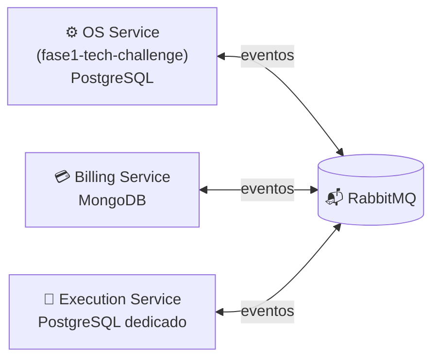
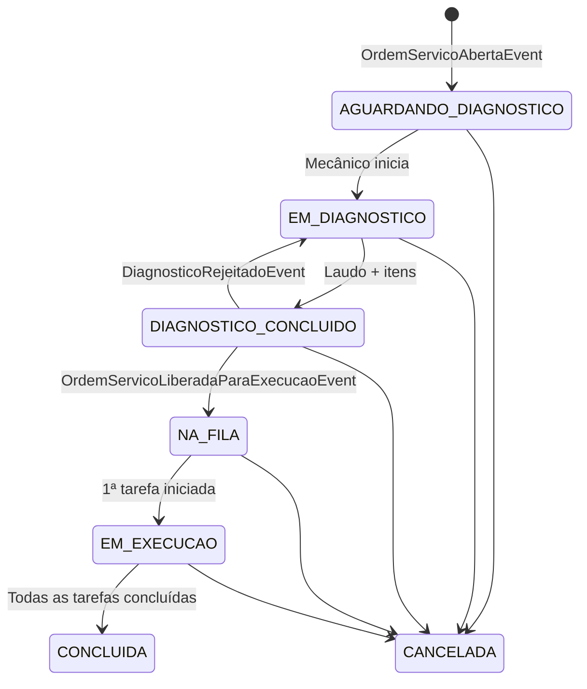

# 🔧 Execution Service — Diagnóstico e Produção

Microsserviço de **chão de oficina** do Tech Challenge (Fase 4 — SOAT/FIAP). É responsável por:

- **Diagnóstico técnico**: o mecânico inspeciona o veículo, aponta o tempo e emite o laudo com serviços/peças sugeridos.
- **Fila de produção**: fila FIFO das OS liberadas após aprovação e pagamento do orçamento.
- **Apontamento de tarefas**: início/fim de cada reparo por mecânico.
- **Comunicação de status** ao OS Service via eventos (Saga coreografada sobre RabbitMQ).

> 📋 Plano arquitetural completo: [docs/PLANO_DESACOPLAMENTO_SERVICO_EXECUCAO.md](docs/PLANO_DESACOPLAMENTO_SERVICO_EXECUCAO.md)  
> 📐 Fluxo de criação da OS: [docs/FLUXO_CRIACAO_ORDEM_SERVICO.md](docs/FLUXO_CRIACAO_ORDEM_SERVICO.md)

## Posição no ecossistema



Nenhum serviço acessa o banco de outro. Os contratos de eventos vêm do pacote compartilhado [`Fiap.TechChallenge.Contracts`](../contracts).

## Máquina de estados (`OrdemProducao`)



## Stack

| Item | Tecnologia |
|---|---|
| Runtime | .NET 8 (ASP.NET Core) |
| Banco | PostgreSQL 16 + EF Core 8 (Npgsql) |
| Mensageria | RabbitMQ 3.13 + MassTransit 8.x (Outbox/Inbox) |
| Testes | xUnit, FluentAssertions, NetArchTest, Testcontainers, Reqnroll |
| Deploy | Docker (non-root) + Kubernetes (EKS, Kustomize) |

## Estrutura

```
src/
├── Fiap.TechChallenge.Execution.Domain/          # Agregado OrdemProducao, regras e estados
├── Fiap.TechChallenge.Execution.Application/     # Casos de uso, queries e consumers
├── Fiap.TechChallenge.Execution.Infrastructure/  # EF Core, MassTransit, AWS SSM
└── Fiap.TechChallenge.Execution.Api/             # Controllers, middlewares, composição
tests/
└── Fiap.TechChallenge.Execution.UnitTests/       # Unitários + testes de arquitetura
```

Regras de dependência (verificadas por teste com NetArchTest): `Domain` não depende de nada → `Application` depende de `Domain` → `Infrastructure` implementa as interfaces → `Api` faz a composição.

## Como executar localmente

### Pré-requisitos
- .NET SDK 8
- Docker + Docker Compose

### Com Docker Compose (API + PostgreSQL + RabbitMQ)

```bash
cp .env.example .env   # opcional
docker compose up -d --build
```

| Recurso | URL |
|---|---|
| Swagger | http://localhost:8082/swagger |
| Liveness | http://localhost:8082/health/live |
| Readiness | http://localhost:8082/health/ready |
| RabbitMQ Management | http://localhost:15672 (guest/guest) |
| PostgreSQL | `localhost:5433` — db `techchallenge_execution_db`, user `execution` |

### Somente a API (dotnet)

```bash
docker compose up -d execution-db rabbitmq
dotnet run --project src/Fiap.TechChallenge.Execution.Api
# http://localhost:5082/swagger
```

### Testes

```bash
dotnet test
```

## Variáveis de configuração

| Variável | Descrição | Produção (AWS SSM) |
|---|---|---|
| `ConnectionStrings__ExecutionDb` | PostgreSQL exclusivo da Execução | `/techchallenge/prod/execution/db_connection_string` |
| `ConnectionStrings__RabbitMq` | Broker compartilhado | `/techchallenge/prod/rabbitmq_connection_string` |
| `Jwt__Secret` | Validação dos tokens de staff | `/techchallenge/prod/jwt_secret` |

## Roadmap de implementação

- [x] **Etapa 0** — Pacote de contratos `Fiap.TechChallenge.Contracts`
- [x] **Etapa 1** — Repositório, solução, Dockerfile e docker-compose
- [x] **Etapa 2** — Domínio (agregado `OrdemProducao` e máquina de estados)
- [ ] **Etapa 3** — Persistência (PostgreSQL + EF Core)
- [ ] **Etapa 4** — Casos de uso e API REST
- [ ] **Etapa 5** — Mensageria e Saga (MassTransit + Outbox/Inbox)
- [ ] **Etapa 6** — Integração com OS e Billing
- [ ] **Etapa 7** — Qualidade, infraestrutura e CI/CD
- [ ] **Etapa 8** — Entregáveis (ADRs, Postman, vídeo)
