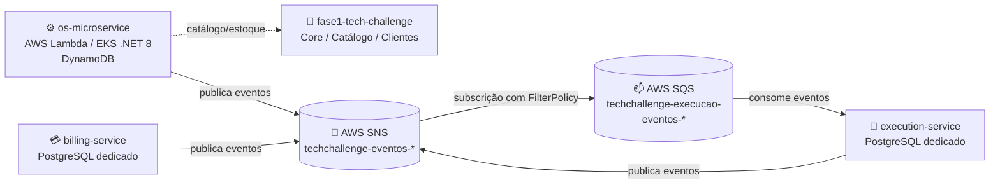
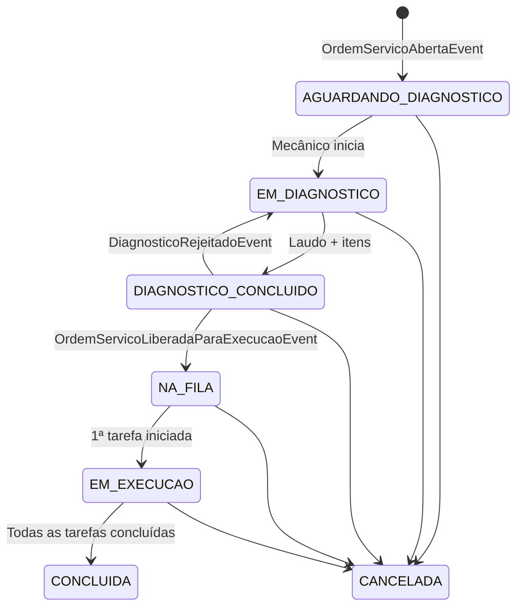

# 🔧 Execution Service — Diagnóstico e Produção

Microsserviço de **chão de oficina** do Tech Challenge (Fase 4 — SOAT/FIAP). É responsável por:

- **Diagnóstico técnico**: o mecânico inspeciona o veículo, aponta o tempo e emite o laudo com serviços/peças sugeridos.
- **Fila de produção**: fila FIFO das OS liberadas após aprovação e pagamento do orçamento.
- **Apontamento de tarefas**: início/fim de cada reparo por mecânico.
- **Comunicação de status** ao OS Service e ao Billing Service via eventos (Saga coreografada sobre AWS SNS / SQS).

> 📋 Plano arquitetural completo: [docs/PLANO_DESACOPLAMENTO_SERVICO_EXECUCAO.md](docs/PLANO_DESACOPLAMENTO_SERVICO_EXECUCAO.md)  
> 📐 Fluxo de criação da OS: [docs/FLUXO_CRIACAO_ORDEM_SERVICO.md](docs/FLUXO_CRIACAO_ORDEM_SERVICO.md)  
> 📖 Especificação viva: [docs/SPEC.md](docs/SPEC.md)

## Posição no ecossistema



Nenhum serviço acessa o banco de outro. Os contratos de eventos vêm do projeto compartilhado [`Fiap.TechChallenge.Contracts`](../shared/src/Fiap.TechChallenge.Contracts).

## Máquina de estados (`OrdemProducao`)



## Implementação e Justificativa do Saga Pattern

### Estratégia adotada: Saga Coreografada sobre AWS SNS + SQS

O `execution-service` participa do fluxo distribuído da oficina utilizando o padrão **Saga Coreografada**, sem orquestrador central:

- **Publicação de eventos ([`AwsSnsEventPublisher`](src/Fiap.TechChallenge.Execution.Infrastructure/Messaging/AwsSnsEventPublisher.cs)):** publica eventos de integração no tópico unificado AWS SNS (`EVENTOS_TOPIC_ARN`, padrão local `techchallenge-eventos-local` / produção `techchallenge-eventos-prod`) anexando `MessageAttributes` padronizados (`tipoEvento`, `origem = techchallenge.execucao`, `idOrdemServico` e `X-Correlation-ID`).
- **Consumo de eventos ([`ExecutionSqsBackgroundWorker`](src/Fiap.TechChallenge.Execution.Infrastructure/Messaging/ExecutionSqsBackgroundWorker.cs)):** `BackgroundService` que realiza polling na fila dedicada AWS SQS (`EXECUCAO_QUEUE_URL`, padrão local `techchallenge-execucao-eventos-local` / produção `techchallenge-execucao-eventos-prod`) assinada no SNS com `FilterPolicy` por `tipoEvento`, propagando `CorrelationContext` para logs estruturados.
- **Outbox no EF Core:** o projeto mantém também a configuração de `AddEntityFrameworkOutbox<AppDbContext>` no PostgreSQL ([`MassTransitConfiguration.cs`](src/Fiap.TechChallenge.Execution.Infrastructure/Messaging/MassTransitConfiguration.cs)), enquanto o tráfego inter-serviços em runtime ocorre diretamente via AWS SNS/SQS.

### Justificativa da escolha (Coreografada vs. Orquestrada)

1. **Desacoplamento temporal e autonomia de Bounded Context:** na operação de oficina, diagnóstico técnico, aprovação/pagamento do orçamento e execução física das tarefas levam minutos ou horas e dependem de ações humanas assíncronas. A coreografia evita manter estado de longa duração ou locks distribuídos em um orquestrador central.
2. **Eliminação de ponto único de falha e acoplamento direto:** `execution-service`, `os-microservice` e `billing-service` só conhecem os contratos de eventos em `Fiap.TechChallenge.Contracts` e interagem via AWS SNS/SQS com DLQs dedicadas, sem acoplamento síncrono nem acesso a bancos alheios.
3. **Evolução e escalabilidade independentes:** novos consumidores podem assinar o tópico SNS aplicando `FilterPolicy` por `tipoEvento` sem alterar os produtores existentes.

### Eventos consumidos e publicados

| Direção | Evento | Origem / Destino | Efeito no `execution-service` / Ecossistema |
|---|---|---|---|
| **Consumido** | `OrdemServicoAbertaEvent` (ou `OrdemServicoCriada`) | `os-microservice` → SQS | Cria a `OrdemProducao` em `AGUARDANDO_DIAGNOSTICO` com `ClienteSnapshot`, `VeiculoSnapshot` e `FilialId` |
| **Consumido** | `OrdemServicoLiberadaParaExecucaoEvent` | `os-microservice` → SQS | Associa as `TarefaProducao` aprovadas e move a ordem de `DIAGNOSTICO_CONCLUIDO` para `NA_FILA` (fila FIFO) |
| **Consumido** | `DiagnosticoRejeitadoEvent` | `os-microservice` → SQS | Reabre o diagnóstico (`DIAGNOSTICO_CONCLUIDO` → `EM_DIAGNOSTICO`) registrando o motivo no histórico |
| **Consumido** | `OrdemServicoCanceladaEvent` (ou `OrdemServicoCancelada`) | `os-microservice` → SQS | **Compensação A:** cancela a `OrdemProducao` e interrompe tarefas `Pendente` / `EmExecucao` (`Interrompida`) |
| **Publicado** | `DiagnosticoIniciadoEvent` | `IniciarDiagnosticoUseCase` → SNS | Notifica início da inspeção técnica pelo mecânico (`EM_DIAGNOSTICO`) |
| **Publicado** | `DiagnosticoTecnicoConcluidoEvent` | `FinalizarDiagnosticoUseCase` → SNS | Envia laudo, duração, `ServicosSugeridos` e `PecasSugeridas` para orçamento/precificação |
| **Publicado** | `ProducaoIniciadaEvent` | `IniciarTarefaUseCase` → SNS | Emitido apenas na transição `NA_FILA` → `EM_EXECUCAO` (1ª tarefa iniciada) |
| **Publicado** | `ProducaoFinalizadaEvent` | `FinalizarTarefaUseCase` → SNS | Emitido quando 100% das tarefas são concluídas (`CONCLUIDA`), com `DataHoraFim` e `DuracaoTotalMinutos` |
| **Publicado** | `ProducaoCanceladaEvent` | `CancelarProducaoUseCase` → SNS | **Compensação B:** notifica cancelamento interno da produção para estorno de pagamento (`billing-service`) e estoque (`os-microservice`) |

### Fluxos de compensação e guardas de idempotência

- **Compensação Externa (`OrdemServicoCanceladaEvent` / `DiagnosticoRejeitadoEvent`):** quando o pagamento é recusado/expirado ou a OS é cancelada externamente, `ExecutionSqsBackgroundWorker` aciona `ordem.Cancelar(...)`, movendo o agregado para `CANCELADA` e interrompendo todas as tarefas em aberto (`StatusTarefaProducao.Interrompida`). Caso o laudo tenha inconsistências de catálogo/estoque, `DiagnosticoRejeitadoEvent` retorna o status para `EM_DIAGNOSTICO`.
- **Compensação Interna (`CancelarProducaoUseCase` → `ProducaoCanceladaEvent`):** quando a produção é cancelada na oficina (`POST /api/v1/producao/{id}/cancelar`), a ordem é marcada como `CANCELADA` (se ainda não concluída) e `ProducaoCanceladaEvent` é publicado no SNS para estorno financeiro e liberação de peças. Ordens já `CONCLUIDA` bloqueiam cancelamento com `TransicaoEstadoInvalidaException`.
- **Guardas de idempotência:**
  - `OrdemServicoAbertaEvent`: verifica `ExistePorOrdemServicoIdAsync(evento.OsId)` antes da inserção (respaldado pelo índice único `uk_ordens_producao_os`), descartando reentregas duplicadas.
  - `OrdemServicoLiberadaParaExecucaoEvent`: ignora reentrega se a ordem já estiver em `NaFila`, `EmExecucao` ou `Concluida`.
  - `DiagnosticoRejeitadoEvent`: `DiagnosticoRejeitadoConsumer` descarta se já estiver em `EmDiagnostico` ou em status incompatível; `OrdemProducao.ReabrirDiagnostico` exige status `DiagnosticoConcluido`.
  - `OrdemServicoCanceladaEvent` e `CancelarProducaoUseCase`: `OrdemProducao.Cancelar` retorna imediatamente se `Status == Cancelada` e o caso de uso evita republicar `ProducaoCanceladaEvent` quando já cancelada.
  - `ProducaoIniciadaEvent`: só é publicado quando `OrdemProducao.IniciarTarefa` retorna `primeiraTarefaIniciada = true` (transição única `NaFila` → `EmExecucao`).
  - **Concorrência otimista:** a propriedade `Versao` é validada e incrementada no `OrdemProducaoRepository`, convertendo conflitos de persistência em `ConflitoConcorrenciaException` (HTTP 409).

## Stack

| Item | Tecnologia |
|---|---|
| Runtime | .NET 8 (ASP.NET Core) |
| Banco | PostgreSQL 16 + EF Core 8 (Npgsql) |
| Mensageria | AWS SNS + SQS (`AwsSnsEventPublisher` e `ExecutionSqsBackgroundWorker`) + EF Core Outbox |
| Observabilidade | OpenTelemetry (Traces/Métricas/Logs OTLP) + Prometheus (`/metrics`) |
| Testes | xUnit, FluentAssertions, NetArchTest, NSubstitute, Testcontainers |
| Deploy | Docker (non-root) + Kubernetes (EKS, Kustomize em `k8s/base/`) |

## Estrutura

```
src/
├── Fiap.TechChallenge.Execution.Domain/          # Agregado OrdemProducao, regras e estados
├── Fiap.TechChallenge.Execution.Application/     # Casos de uso, queries e consumers
├── Fiap.TechChallenge.Execution.Infrastructure/  # EF Core, AWS SQS Worker, AWS SNS, AWS SSM
└── Fiap.TechChallenge.Execution.Api/             # Controllers, middlewares, Swagger, composição
tests/
├── Fiap.TechChallenge.Execution.UnitTests/       # Unitários + testes de arquitetura (NetArchTest)
└── Fiap.TechChallenge.Execution.IntegrationTests/# Integração com PostgreSQL (Testcontainers) e API
k8s/
└── base/                                         # Manifestos Kustomize (ConfigMap, Deployment, Service)
```

Regras de dependência (verificadas por teste com NetArchTest): `Domain` não depende de nada → `Application` depende de `Domain` → `Infrastructure` implementa as interfaces → `Api` faz a composição.

## Como executar localmente

### Pré-requisitos
- .NET SDK 8
- Docker + Docker Compose

### Com Docker Compose (Ecossistema completo + PostgreSQL + Floci AWS)

```bash
docker compose -f ../shared/docker-compose.yml up -d --build
```

| Recurso | URL |
|---|---|
| Swagger UI | http://localhost:8082/swagger |
| Swagger JSON | http://localhost:8082/swagger/v1/swagger.json |
| Liveness | http://localhost:8082/health/live |
| Readiness | http://localhost:8082/health/ready |
| Métricas Prometheus | http://localhost:8082/metrics |
| Floci UI (AWS Console) | http://localhost:4500 |
| PostgreSQL | `localhost:5433` — db `techchallenge_execution_db`, user `execution` |

### Somente a API (dotnet)

```bash
docker compose -f ../shared/docker-compose.yml up -d execution-db floci
dotnet run --project src/Fiap.TechChallenge.Execution.Api
# http://localhost:5082/swagger
```

## Variáveis de configuração

Variáveis lidas pela aplicação em [`DependencyInjection.cs`](src/Fiap.TechChallenge.Execution.Infrastructure/DependencyInjection.cs), [`MassTransitConfiguration.cs`](src/Fiap.TechChallenge.Execution.Infrastructure/Messaging/MassTransitConfiguration.cs), [`ExecutionSqsBackgroundWorker.cs`](src/Fiap.TechChallenge.Execution.Infrastructure/Messaging/ExecutionSqsBackgroundWorker.cs), [`AwsSnsEventPublisher.cs`](src/Fiap.TechChallenge.Execution.Infrastructure/Messaging/AwsSnsEventPublisher.cs), [`JwtConfiguration.cs`](src/Fiap.TechChallenge.Execution.Api/Configurations/JwtConfiguration.cs) e [`k8s/base/configmap.yaml`](k8s/base/configmap.yaml):

| Variável | Descrição | Produção (Kubernetes / AWS SSM) |
|---|---|---|
| `ConnectionStrings__ExecutionDb` | Connection string PostgreSQL exclusiva (ou `DB_CONNECTION_STRING`) | Secret `execution-service-secrets` (`connection-string`) ou SSM `/techchallenge/prod/execution/db_connection_string` |
| `Jwt__Secret` | Chave HMAC-SHA256 para validação de tokens de staff (ou `JWT_SECRET`) | Secret `execution-service-secrets` (`jwt-secret`) ou SSM `/techchallenge/prod/jwt_secret` |
| `Jwt__Issuer` / `JWT_ISSUER` | Emissor esperado do token JWT | `TechChallenge` |
| `Jwt__Audience` / `JWT_AUDIENCE` | Público esperado do token JWT | `techchallenge.com.br` |
| `AWS_REGION` | Região AWS dos clientes SNS/SQS | `sa-east-1` |
| `EXECUCAO_QUEUE_URL` | URL da fila SQS consumida pelo `ExecutionSqsBackgroundWorker` | `https://sqs.sa-east-1.amazonaws.com/000000000000/techchallenge-execucao-eventos-prod` (local: `http://floci:4566/000000000000/techchallenge-execucao-eventos-local`) |
| `EVENTOS_TOPIC_ARN` | ARN do tópico SNS onde o `AwsSnsEventPublisher` publica eventos | `arn:aws:sns:sa-east-1:000000000000:techchallenge-eventos-prod` (local: `...-local`) |
| `EVENTO_ORIGEM` | Origem do serviço nos manifestos Kubernetes (no publisher, `SnsMessageAttributes.Origens.ExecutionService`) | `techchallenge.execucao` |
| `AWS_SERVICE_URL` | Endpoint AWS customizado (usado apenas localmente com Floci; omitido no EKS) | — (local: `http://floci:4566`) |
| `AWS_SSM_ENABLED` | Habilita fallback automático para o AWS SSM Parameter Store | `true` (quando sem Secret direto) |
| `OTEL_SERVICE_NAME` | Nome do serviço na telemetria OpenTelemetry | `techchallenge-execution-service` |
| `OTEL_EXPORTER_OTLP_ENDPOINT` | Endpoint OTLP para traces, métricas e logs | Collector OTel no cluster / compose |

## Evidências de Testes e Cobertura de Código (≥ 80%)

### Resultados verificados da suíte unitária

Execução validada com [`coverlet.runsettings`](coverlet.runsettings) (excluindo `[*Tests*]*`, `[Fiap.TechChallenge.Contracts]*` e `**/Migrations/*.cs`) sobre o projeto [`Fiap.TechChallenge.Execution.UnitTests`](tests/Fiap.TechChallenge.Execution.UnitTests/Fiap.TechChallenge.Execution.UnitTests.csproj):

| Métrica | Valor observado |
|---|---|
| **Testes executados** | **109** (`Passed: 109`, `Failed: 0`, `Skipped: 0`) |
| **Cobertura de linhas (`line-rate`)** | **86,75%** (`0.8675` — `1644` de `1895` linhas válidas cobertas) |
| **Cobertura de branches (`branch-rate`)** | **76,71%** (`0.7671` — `504` de `657` branches cobertos) |

Detalhamento por camada (`coverage.cobertura.xml`):

| Camada / Assembly | Cobertura de linhas | Cobertura de branches |
|---|---|---|
| `Fiap.TechChallenge.Execution.Domain` | `88,51%` | `81,12%` |
| `Fiap.TechChallenge.Execution.Application` | `89,80%` | `80,26%` |
| `Fiap.TechChallenge.Execution.Infrastructure` | `87,36%` | `70,16%` |
| `Fiap.TechChallenge.Execution.Api` | `77,58%` | `79,76%` |

> ℹ️ Existe também separadamente o projeto [`tests/Fiap.TechChallenge.Execution.IntegrationTests`](tests/Fiap.TechChallenge.Execution.IntegrationTests/Fiap.TechChallenge.Execution.IntegrationTests.csproj) com testes de repositório PostgreSQL (Testcontainers) e API (`WebApplicationFactory`), não incluído nos números unitários acima por exigir runtime Docker ativo.

### Comandos para reprodução local

```bash
dotnet build src/Fiap.TechChallenge.Execution.Api/Fiap.TechChallenge.Execution.Api.csproj --configuration Release
dotnet build tests/Fiap.TechChallenge.Execution.UnitTests/Fiap.TechChallenge.Execution.UnitTests.csproj --configuration Release
dotnet test tests/Fiap.TechChallenge.Execution.UnitTests/Fiap.TechChallenge.Execution.UnitTests.csproj \
  --configuration Release \
  --no-build \
  --settings coverlet.runsettings \
  --collect:"XPlat Code Coverage" \
  --results-directory /tmp/exec-test-results
```

### Qualidade contínua (CI/CD e SonarCloud)

- **SonarCloud:** workflow [`.github/workflows/sonar.yml`](.github/workflows/sonar.yml) analisa o projeto `SOAT-FIAP-2026_execution-service` (organização `soat-fiap-2026`), enviando `TestResults/**/coverage.opencover.xml` com exclusão de `**/Migrations/**`.
- **CI / CD:** [`.github/workflows/ci.yml`](.github/workflows/ci.yml) executa build, testes com cobertura e validação do build Docker; [`.github/workflows/cd.yml`](.github/workflows/cd.yml) publica a imagem container em `ghcr.io/soat-fiap-2026/execution-service`.

## Roadmap de implementação

- [x] **Etapa 0** — Pacote de contratos `Fiap.TechChallenge.Contracts`
- [x] **Etapa 1** — Repositório, solução, Dockerfile e manifests base
- [x] **Etapa 2** — Domínio (agregado `OrdemProducao` e máquina de estados)
- [x] **Etapa 3** — Persistência (PostgreSQL + EF Core, migrations e `SsmSecretResolver`)
- [x] **Etapa 4** — Casos de uso, queries, `ProducaoController`, JWT e Swagger
- [x] **Etapa 5** — Mensageria e Saga (AWS SNS/SQS com `AwsSnsEventPublisher`, `ExecutionSqsBackgroundWorker` e Outbox EF Core)
- [x] **Etapa 6** — Integração com OS Service e Billing Service via `Fiap.TechChallenge.Contracts` e `shared/docker-compose.yml` (Floci)
- [x] **Etapa 7** — Qualidade, infraestrutura e CI/CD (testes unitários ≥ 80%, IntegrationTests, `k8s/base/`, `ci.yml`, `cd.yml`, `sonar.yml`, OpenTelemetry/Prometheus)
- [ ] **Etapa 8** — Entregáveis finais (Swagger e README concluídos; pendentes: ADRs em `docs/adr/`, collection Postman e vídeo de demonstração)
