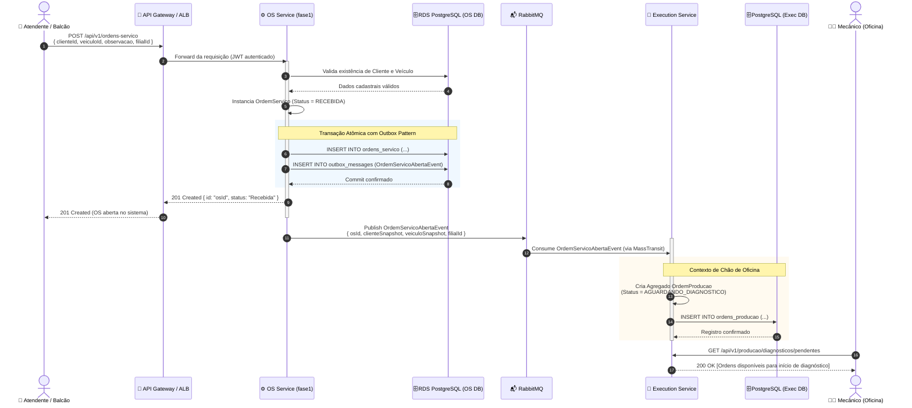
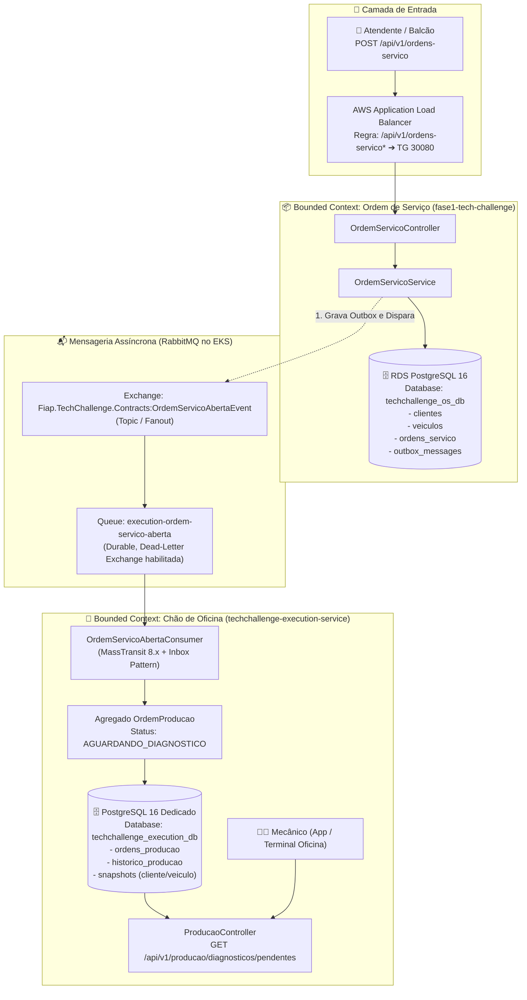

# 📐 Fluxo de Criação da Ordem de Serviço (OS) & Inicialização da Produção
**Pós-Graduação em Software Architecture (SOAT) — FIAP**  
**Contexto:** Desacoplamento entre `fase1-tech-challenge` (OS Service) e `techchallenge-execution-service` (Execution Service)  
**Referência:** [PLANO_DESACOPLAMENTO_SERVICO_EXECUCAO.md](file:///home/gabriel/Desktop/FIAP%20-%20TC/execution-service/docs/PLANO_DESACOPLAMENTO_SERVICO_EXECUCAO.md)

---

## 1. Visão Geral

Este documento descreve o fluxo detalhado de criação de uma Ordem de Serviço (OS) no balcão da oficina e a consequente inicialização assíncrona da Ordem de Produção no chão de oficina.

O fluxo garante o desacoplamento estrito entre os domínios:
1. **OS Service (`fase1-tech-challenge`)**: Dono cadastral do cliente, veículo e da Ordem de Serviço macro (status `RECEBIDA`).
2. **Broker de Mensageria (RabbitMQ)**: Transporte assíncrono e resiliente via evento de integração `OrdemServicoAbertaEvent`.
3. **Execution Service (`techchallenge-execution-service`)**: Dono da operação física, criando a `OrdemProducao` (status `AGUARDANDO_DIAGNOSTICO`) com snapshots imutáveis em seu próprio banco de dados relacional isolado.

---

## 2. Diagrama de Sequência — Criação da OS e Inicialização da Produção



---

## 3. Diagrama de Arquitetura e Bounded Contexts



---

## 4. Máquina de Estados da Transição Inicial

```mermaid
stateDiagram-v2
    direction LR

    state "OS Service (fase1)" as OSContext {
        [*] --> RECEBIDA : POST /api/v1/ordens-servico
        RECEBIDA --> EM_DIAGNOSTICO : DiagnosticoIniciadoEvent
    }

    state "Execution Service" as ExecContext {
        [*] --> AGUARDANDO_DIAGNOSTICO : OrdemServicoAbertaEvent
        AGUARDANDO_DIAGNOSTICO --> EM_DIAGNOSTICO : PATCH /producao/{id}/diagnostico/iniciar
    }

    RECEBIDA -.->|OrdemServicoAbertaEvent| AGUARDANDO_DIAGNOSTICO
```

---

## 5. Especificação dos Contratos de Dados

### 5.1. Requisição HTTP de Criação (OS Service)
* **Endpoint:** `POST /api/v1/ordens-servico`
* **Autenticação:** `Bearer {JWT}` (Role: `Administrador` ou `Operador`)
* **Payload:**
```json
{
  "clienteId": "a1b2c3d4-e5f6-7a8b-9c0d-1e2f3a4b5c6d",
  "veiculoId": "f1e2d3c4-b5a6-9788-7654-3210fedcba98",
  "observacao": "Cliente relata ruído estranho na suspensão dianteira ao frear.",
  "filialId": "sp-matriz"
}
```

### 5.2. Evento de Integração `OrdemServicoAbertaEvent` (MassTransit / RabbitMQ)
* **Contrato:** `Fiap.TechChallenge.Contracts.Events.OrdemServicoAbertaEvent`
* **Payload:**
```json
{
  "eventId": "9b1deb4d-3b7d-4bad-9bdd-2b0d7b3dcb6d",
  "correlationId": "3fa85f64-5717-4562-b3fc-2c963f66afa6",
  "occurredAt": "2026-10-26T23:30:00Z",
  "osId": "3fa85f64-5717-4562-b3fc-2c963f66afa6",
  "filialId": "sp-matriz",
  "cliente": {
    "idCliente": "a1b2c3d4-e5f6-7a8b-9c0d-1e2f3a4b5c6d",
    "nome": "João da Silva",
    "telefone": "+5511999998888"
  },
  "veiculo": {
    "placa": "ABC1D23",
    "modelo": "Honda Civic Touring 1.5",
    "ano": 2022
  }
}
```

> [!IMPORTANT]
> **Privacidade & LGPD:**
> Dados sensíveis desnecessários para a atividade do mecânico (como CPF/CNPJ e e-mail) **não** trafegam no payload do evento e não são persistidos no Execution Service. O mecânico recebe apenas o nome e telefone para comunicação operacional de oficina.

---

## 6. Padrões de Resiliência Aplicados

1. **Transactional Outbox Pattern (no OS Service):**
   - Garante que a abertura da OS e a emissão do evento ocorram na mesma transação ACID do PostgreSQL.
   - Elimina cenários de inconsistência ("OS criada mas evento não publicado" ou vice-versa).
2. **Idempotent Consumer / Inbox Pattern (no Execution Service):**
   - Protegido contra duplicidade de mensagens na rede através de chave de idempotência (`osId`).
   - Se o evento for reentregue pelo broker, a operação não duplicará a `OrdemProducao`.
3. **Dead-Letter Exchange (DLQ):**
   - Caso o Execution Service falhe repetidamente ao processar uma mensagem (ex.: payload corrompido), após 3 tentativas com backoff exponencial ela é encaminhada para `execution-ordem-servico-aberta_error` para auditoria sem travar a fila.
