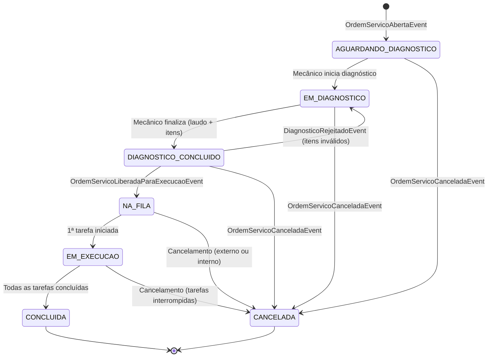
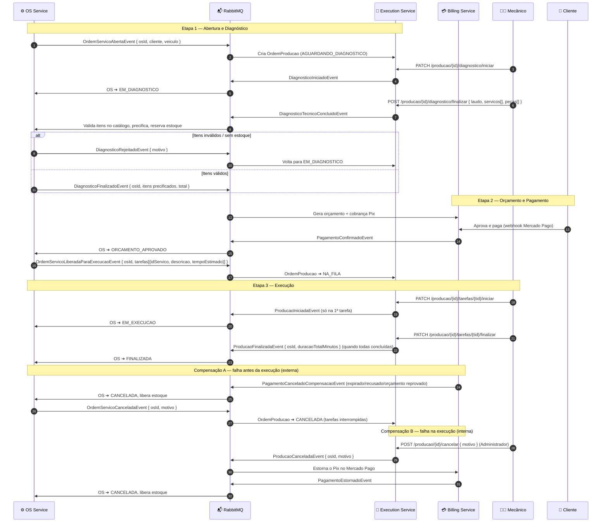
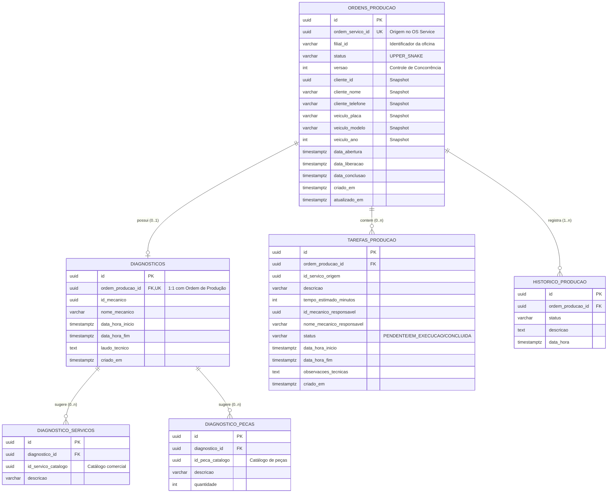
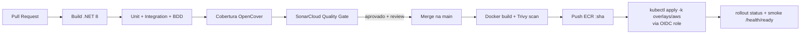

# 📋 Plano Arquitetural: Desacoplamento do Serviço de Execução & Produção (Fase 4)
**Pós-Graduação em Software Architecture (SOAT) — FIAP**  
**Contexto:** Desacoplamento de `fase1-tech-challenge` e criação do **Execution & Production Microservice** (`techchallenge-execution-service`)  
**Data de Emissão:** 21 de Outubro de 2026  
**Última Atualização:** 25 de Outubro de 2026  
**Status:** Plano Executivo Arquitetural (Aprovado e Vigente)

---

## 0. Análise de Aderência ao Edital e Premissas Arquiteturais

### 0.1. Matriz de Conformidade com o Edital (Fase 4)

| # | Requisito da FASE 4 | Atendimento na Arquitetura Atual | Seções de Referência |
|---|---|---|---|
| R1 | Gerenciar a **fila de execução** da OS | ✅ Fila operacional FIFO ordenada por liberação (`GET /api/v1/producao/fila`), com isolamento em PostgreSQL (índice B-Tree condicional) e transações ACID | 2.4, 5, 6 |
| R2 | **Atualizar status durante diagnóstico** e reparos | ✅ O Execution Service é o dono integral do diagnóstico e dos reparos, gerencia a máquina de estados completa (`AGUARDANDO_DIAGNOSTICO` ➔ `EM_DIAGNOSTICO` ➔ `DIAGNOSTICO_CONCLUIDO` ➔ `NA_FILA` ➔ `EM_EXECUCAO` ➔ `CONCLUIDA`) e publica os eventos de sincronização com o OS Service | 1, 2.3, 2.4, 4.2, 6 |
| R3 | **Comunicar finalização** ao OS Service | ✅ Publicação assíncrona de `ProducaoFinalizadaEvent` com duração real e apontamentos consolidados via RabbitMQ | 4.2, 4.3 |
| R4 | Repositório, infraestrutura e **banco próprios** | ✅ Repositório dedicado `techchallenge-execution-service`, banco PostgreSQL 16 dedicado (`techchallenge_execution_db`, usuário exclusivo) e manifestos K8s dedicados | 3, 5, 9.2 |
| R5 | REST síncrono **quando necessário** + mensageria | ✅ REST síncrono para operações de chão de oficina (mecânicos) e mensageria assíncrona (RabbitMQ + MassTransit v8) para comunicação inter-serviços | 4.4, 6 |
| R6 | Nenhum serviço acessa o banco de outro | ✅ Bancos totalmente desacoplados (OS: PostgreSQL RDS, Billing: MongoDB 7.0 NoSQL, Execução: PostgreSQL 16 dedicado) e payloads contendo apenas identificadores e snapshots essenciais | 2.1, 3 |
| R7 | Saga com **rollback e compensação em qualquer etapa** | ✅ Saga Coreografada com compensação externa (reprovação/cancelamento de pagamento) e interna (cancelamento de produção com estorno no Pix e liberação de estoque), respaldadas por Outbox, Inbox e DLQ | 4.2, 4.5 |
| R8 | Escolha da Saga **documentada e justificada no README** | ✅ ADR formalizada (`0002-saga-coreografada`) e documentada detalhadamente no README com justificativa e prós/contras | 4.1, 8.4 |
| R9 | Testes unitários, **BDD em fluxo completo**, cobertura ≥ 80%, SonarQube | ✅ Testes unitários (xUnit), integração com Testcontainers (PostgreSQL 16 e RabbitMQ), BDD completo com Reqnroll cobrindo fluxo ponta a ponta e compensações, e Quality Gate (≥ 80%) no SonarCloud | 8 |
| R10 | CI/CD com build, testes, qualidade e **deploy automatizado no K8s** | ✅ Pipeline no GitHub Actions: CI em PRs e CD automático na `main` realizando build, push no ECR e deploy no EKS via OIDC | 9.4 |
| R11 | **Branch main protegida** com PR obrigatório e checks | ✅ Regras de branch protection configuradas no GitHub: PR obrigatório, approval e checks bloqueantes de CI | 9.4 |
| R12 | Observabilidade da Fase 3 (OTel, Prometheus, Loki, Tempo) | ✅ Tracing distribuído fim a fim com OpenTelemetry e propagação de contexto W3C pelo MassTransit, métricas Prometheus e logs estruturados no Loki | 9.5 |
| R13 | Entregáveis: Dockerfile, manifestos, evidência de cobertura, docs, **Swagger/Postman** | ✅ Dockerfile multi-stage, manifestos Kustomize, collection Postman, Swagger e relatório de cobertura | 7, 8, 11 |
| R14 | Vídeo: fluxo completo, Saga com falha, deploy, rastreamento | ✅ Roteiro de demonstração até 15 min estruturado abordando todos os quesitos avaliativos | 12 |

### 0.2. Premissas de Integração com a Base de Código Existente

| Componente / Aspecto | Implementação no Ecossistema | Diretriz para o Execution Service |
|---|---|---|
| **Autenticação de Staff** | Emitido pelo OS Service ([TokenService.cs](file:///home/gabriel/Desktop/FIAP%20-%20TC/fase1-tech-challenge/src/Fiap.TechChallenge.External/Services/TokenService.cs)) via `POST /api/v1/autenticacao` com claims `ClaimTypes.Role`, `ClaimTypes.Name` e `UsuarioId` | O Execution Service valida o token JWT simétrico (HMAC-SHA256); mecânico identificado via `UsuarioId` |
| **Perfis de Acesso (Roles)** | `Administrador`, `Operador` existentes no PostgreSQL | Seed da nova role `Mecanico` no OS Service; autorização `[Authorize(Roles = "Mecanico,Administrador")]` |
| **Segredos no AWS SSM** | Segredo simétrico compartilhado em `/techchallenge/prod/jwt_secret` e broker em `/techchallenge/prod/rabbitmq_connection_string` | Reutilizar parâmetros SSM existentes para manter a governança com o Billing e infraestrutura |
| **Roteamento no ALB** | Target groups para porta 30080 (OS) e 30300 (Grafana) | Provisionar novo Target Group para `NodePort 30082` e regra de listener no ALB para o path `/api/v1/producao*` |
| **Infraestrutura no EKS** | Ausência prévia de RabbitMQ no cluster | Provisionamento de RabbitMQ (Helm Bitnami) e PostgreSQL 16 (StatefulSet/RDS no namespace data) no EKS via Terraform |
| **Propriedade dos Dados** | OS Service é o dono cadastral de clientes, veículos e catálogo (preços/peças) | OS Service emite `OrdemServicoLiberadaParaExecucaoEvent` com snapshots e tarefas; Execução não consulta banco de dados alheio |
| **Padronização de Status** | Códigos de status em `UPPER_SNAKE` ([StatusOrdemServico.cs](file:///home/gabriel/Desktop/FIAP%20-%20TC/fase1-tech-challenge/src/Fiap.TechChallenge.Domain/Entities/StatusOrdemServico.cs)) | Padrão `UPPER_SNAKE` rigorosamente mantido na persistência PostgreSQL (EF Core) e contratos de eventos |
| **Ciclo de Eventos** | `ProducaoIniciadaEvent` emitido de forma idempotente | Disparado apenas na transição do agregado `NA_FILA ➔ EM_EXECUCAO` (primeira tarefa iniciada) |

### 0.3. Decisões Arquiteturais Consolidadas

1. **Dono do Diagnóstico Técnico (Execution Service):** O microsserviço de Execução assume a responsabilidade integral pelo fluxo de diagnóstico no chão de oficina, atendendo estritamente ao Requisito R2 do edital ("atualizar status durante diagnóstico e reparos"). O OS Service não gerencia mais o início/fim de diagnóstico: ele apenas cria a OS e publica `OrdemServicoAbertaEvent`. A partir desse ponto, o mecânico inspeciona o veículo na Execução (`AGUARDANDO_DIAGNOSTICO` ➔ `EM_DIAGNOSTICO`), apontando o tempo gasto e emitindo o laudo com os serviços e peças sugeridos (`DIAGNOSTICO_CONCLUIDO`). O OS Service é notificado via evento assíncrono para realizar a precificação de catálogo e a reserva de estoque.
2. **Broker de Mensageria:** RabbitMQ 3.13 no cluster EKS com MassTransit 8.x, garantindo uniformidade com o Billing Service e custo zero com serviços gerenciados de mensageria na AWS.
3. **Persistência Relacional: PostgreSQL 16 com Entity Framework Core.** O Execution Service adota banco de dados relacional PostgreSQL 16 dedicado (`techchallenge_execution_db`), assegurando integridade referencial estrita para laudos, peças e tarefas de reparo, além de suporte nativo a transações ACID e ao Transactional Outbox (`MassTransit.EntityFrameworkCore`). O edital é integralmente cumprido através do ecossistema poliglota: OS Service (PostgreSQL), Billing Service (MongoDB NoSQL) e Execution Service (PostgreSQL).
4. **Governança de Contratos:** Pacote centralizado `Fiap.TechChallenge.Contracts` publicado no GitHub Packages, assegurando namespaces e URNs idênticas de mensagens no MassTransit entre OS Service, Billing Service e Execution Service.
5. **Multi-Filial:** Inclusão nativa de `filialId` no agregado `OrdemProducao` e nos filtros de fila e diagnóstico para viabilizar escala multi-oficina.

---

## 📑 Sumário
1. [Contexto e Motivação](#1-contexto-e-motivação-do-desacoplamento)
2. [Desacoplamento das Entidades do Monólito](#2-diagnóstico-e-desacoplamento-das-entidades-do-monólito)
3. [Matriz dos Microsserviços](#3-matriz-dos-microsserviços-e-bounded-contexts)
4. [Saga Coreografada, Contratos e Compensação](#4-topologia-e-comunicação-saga-coreografada--rollback)
5. [Estratégia de Banco de Dados: PostgreSQL (SQL) e Schema Relacional](#5-estratégia-de-banco-de-dados-postgresql-sql-e-schema-relacional)
6. [Contratos de API REST](#6-contratos-de-api-rest-techchallenge-execution-service)
7. [Arquitetura de Software](#7-arquitetura-de-software-net-8-clean-architecture)
8. [Qualidade, Testes e BDD](#8-qualidade-de-código-e-testes-bdd-reqnrollgherkin)
9. [Infraestrutura, CI/CD e Observabilidade](#9-operação-em-nuvem-infraestrutura-cicd-e-observabilidade)
10. [Impactos nos Demais Repositórios](#10-impactos-e-refatoração-nos-demais-repositórios)
11. [Checklist de Implementação](#11-roteiro-de-implementação-passo-a-passo-checklist)
12. [Roteiro do Vídeo de Demonstração](#12-roteiro-do-vídeo-de-demonstração-até-15-min)

---

## 1. Contexto e Motivação do Desacoplamento

Conforme **[FASE_4.md](file:///home/gabriel/Desktop/FIAP%20-%20TC/FASE_4.md)** e **[CONTEXTO_COMPLETO_PROJETO_SOAT.md](file:///home/gabriel/Desktop/FIAP%20-%20TC/CONTEXTO_COMPLETO_PROJETO_SOAT.md)**, a oficina atingiu escala nacional com múltiplas filiais, exigindo **no mínimo 3 microsserviços independentes**:

1. **OS Service (`fase1-tech-challenge`)**: Abertura da OS, clientes, veículos, catálogo comercial (serviços/peças/estoque), precificação, aprovação de orçamentos, status macro e **histórico** da OS. **Não executa diagnóstico nem reparos técnicos.**
2. **Billing & Payment Service (`techchallenge-billing-service`)**: Orçamentos, checkout via Mercado Pago (PIX), webhooks e estornos.
3. **Execution & Production Service (`techchallenge-execution-service`)**: Chão de oficina completo — **diagnóstico técnico** (inspeção, apontamento de tempo e laudo), gerenciamento da **fila operacional de produção**, apontamento de tempo de tarefas por mecânico e comunicação de finalização.

### Diagnóstico do Estado Atual no Monólito
* **Gargalo no chão de oficina**: Apontamentos de início/fim disputavam o PostgreSQL com cadastros e pagamentos.
* **Sem fila operacional especializada**: Mecânicos filtravam listas gerais de OS em vez de consumir uma esteira ordenada.
* **Sem autonomia**: Falhas no faturamento/gateway afetavam a operação física da oficina.
* **Diagnóstico e reparo acoplados ao cadastro comercial**: Endpoints como `iniciar-diagnostico`, `finalizar-diagnostico`, `servicos/{id}/iniciar` e `servicos/{id}/finalizar` viviam em [OrdemServicoController.cs](file:///home/gabriel/Desktop/FIAP%20-%20TC/fase1-tech-challenge/src/Fiap.TechChallenge.Api/Controllers/V1/OrdemServicoController.cs).
* **Transferência do Diagnóstico para o Execution Service**: A inspeção técnica, o registro de laudo e a listagem de peças e serviços necessários são tarefas do mecânico no chão de oficina. Ao assumir o diagnóstico, o Execution Service atualiza status ativamente desde o primeiro contato com o veículo, garantindo estrita aderência ao requisito R2 do edital.

---

## 2. Diagnóstico e Desacoplamento das Entidades do Monólito

```
[ fase1-tech-challenge (Monólito) ]                  [ techchallenge-execution-service (Novo) ]
┌───────────────────────────────┐                    ┌────────────────────────────────────────┐
│ Cliente (Tabela Relacional)   │ ──── Snapshot ───> │ ClienteSnapshot (Value Object Imutável)│
│ Veiculo (Tabela Relacional)   │ ──── Snapshot ───> │ VeiculoSnapshot (Value Object Imutável)│
│ Permissao & Usuario (Tabelas) │ ──── Stateless ──> │ JWT Claims (Role + UsuarioId)          │
│ Servico (Preço + Tempo)       │ ─ Expurgar Preço ─>│ TarefaProducao (Tempo Estimado + Real) │
│ OS.DataInicioDiagnostico etc. │ ──── Migrar ─────> │ Diagnostico (Laudo + Itens sugeridos)  │
│ StatusOrdemServico (Global)   │ ── Sub-estados ──> │ StatusOrdemProducao + Eventos          │
└───────────────────────────────┘                    └────────────────────────────────────────┘
```

### 2.1. [Cliente.cs](file:///home/gabriel/Desktop/FIAP%20-%20TC/fase1-tech-challenge/src/Fiap.TechChallenge.Domain/Entities/Cliente.cs)
* **Contexto de Execução:** O mecânico só precisa de identificação básica para contato/chamamento.
* **Decisão:** Não replicar tabelas. Usar um **Value Object imutável** recebido em `OrdemServicoAbertaEvent`:
  ```csharp
  public record ClienteSnapshot(Guid IdCliente, string Nome, string? Telefone);
  public record VeiculoSnapshot(string Placa, string Modelo, int Ano);
  ```
* **LGPD:** CPF/CNPJ e e-mail **não** trafegam para este serviço.

### 2.2. [Permissao.cs](file:///home/gabriel/Desktop/FIAP%20-%20TC/fase1-tech-challenge/src/Fiap.TechChallenge.Domain/Entities/Permissao.cs) e [Usuario.cs](file:///home/gabriel/Desktop/FIAP%20-%20TC/fase1-tech-challenge/src/Fiap.TechChallenge.Domain/Entities/Usuario.cs)
* **Decisão:** Sem `Usuario`/`Permissao` no banco do novo serviço (stateless).
* **Emissor do token de staff:** `POST /api/v1/autenticacao` do OS Service ([TokenService.cs](file:///home/gabriel/Desktop/FIAP%20-%20TC/fase1-tech-challenge/src/Fiap.TechChallenge.External/Services/TokenService.cs)), HMAC-SHA256, com as claims `ClaimTypes.Role`, `ClaimTypes.Name` e `UsuarioId`.
* **Validação:** Mesmo segredo (`/techchallenge/prod/jwt_secret`), `Issuer = fiap-tech-challenge`, `Audience = fiap-api`, iguais aos do Billing.
* **Nova role:** `Mecanico` (seed no fase1). Autorização por policy: `[Authorize(Roles = "Mecanico,Administrador")]`.
* **Identificação do executor:** `User.FindFirst("UsuarioId")` (fica gravado na tarefa) + `ClaimTypes.Name` (snapshot do nome para relatórios).
* **Tokens de cliente (Lambda/CPF)** não têm role e **não** acessam este serviço. O progresso para o cliente continua no `GET /ordens-servico/{id}/progresso` do OS Service, alimentado por eventos.

### 2.3. [Servico.cs](file:///home/gabriel/Desktop/FIAP%20-%20TC/fase1-tech-challenge/src/Fiap.TechChallenge.Domain/Entities/Servico.cs) e [ItemServico.cs](file:///home/gabriel/Desktop/FIAP%20-%20TC/fase1-tech-challenge/src/Fiap.TechChallenge.Domain/Entities/ItemServico.cs)
* **Contexto de Execução:** Preço é irrelevante. O foco é **instrução técnica**, **tempo estimado** e **tempo real**.
* **Decisão:** Aggregate Root **`OrdemProducao`** com entidade filha **`TarefaProducao`** e Value Object **`Diagnostico`**, encapsulando tanto a inspeção diagnóstica quanto a execução física dos reparos:

  ```csharp
  // --- Value Objects e Entidades de Diagnóstico ---
  public record Diagnostico
  {
      public Guid IdMecanico { get; init; }
      public string NomeMecanico { get; init; }
      public DateTime DataHoraInicio { get; init; }
      public DateTime? DataHoraFim { get; init; }
      public string? LaudoTecnico { get; init; }
      public IReadOnlyList<ServicoSugerido> ServicosSugeridos { get; init; } = [];
      public IReadOnlyList<PecaSugerida> PecasSugeridas { get; init; } = [];

      public int? ObterDuracaoMinutos() =>
          DataHoraFim.HasValue
              ? (int)Math.Max(1, Math.Round((DataHoraFim.Value - DataHoraInicio).TotalMinutes))
              : null;
  }

  public record ServicoSugerido(Guid IdServico, string? Descricao = null);
  public record PecaSugerida(Guid IdPeca, int Quantidade, string? Descricao = null);

  // --- Entidade de Tarefa de Reparo ---
  public class TarefaProducao : EntidadeBase
  {
      public Guid IdServicoOrigem { get; private set; }
      public string Descricao { get; private set; }
      public int TempoEstimadoMinutos { get; private set; }
      public Guid? IdMecanicoResponsavel { get; private set; }
      public string? NomeMecanicoResponsavel { get; private set; }
      public StatusTarefaProducao Status { get; private set; }
      public DateTime? DataHoraInicio { get; private set; }
      public DateTime? DataHoraFim { get; private set; }
      public string? ObservacoesTecnicas { get; private set; }

      public void Iniciar(Guid idMecanico, string nomeMecanico)
      {
          if (Status != StatusTarefaProducao.Pendente)
              throw new DomainException("Tarefa já iniciada ou concluída.");

          IdMecanicoResponsavel = idMecanico;
          NomeMecanicoResponsavel = nomeMecanico;
          DataHoraInicio = DateTime.UtcNow;
          Status = StatusTarefaProducao.EmExecucao;
      }

      public void Finalizar(Guid idMecanico, string? observacoes = null)
      {
          if (Status != StatusTarefaProducao.EmExecucao)
              throw new DomainException("A tarefa precisa estar em execução para ser finalizada.");
          if (IdMecanicoResponsavel != idMecanico)
              throw new DomainException("Somente o mecânico responsável pode finalizar a tarefa.");

          DataHoraFim = DateTime.UtcNow;
          ObservacoesTecnicas = observacoes;
          Status = StatusTarefaProducao.Concluida;
      }

      public void Interromper(string motivo)
      {
          if (Status is StatusTarefaProducao.Concluida or StatusTarefaProducao.Interrompida) return;
          DataHoraFim ??= DataHoraInicio.HasValue ? DateTime.UtcNow : null;
          ObservacoesTecnicas = motivo;
          Status = StatusTarefaProducao.Interrompida;
      }

      public int? ObterDuracaoRealMinutos() =>
          DataHoraInicio.HasValue && DataHoraFim.HasValue
              ? (int)Math.Max(1, Math.Round((DataHoraFim.Value - DataHoraInicio.Value).TotalMinutes))
              : null;
  }

  // --- Aggregate Root OrdemProducao ---
  public class OrdemProducao : EntidadeBase
  {
      public Guid OrdemServicoId { get; private set; }
      public string? FilialId { get; private set; }
      public StatusOrdemProducao Status { get; private set; }
      public int Version { get; private set; }
      public ClienteSnapshot Cliente { get; private set; }
      public VeiculoSnapshot Veiculo { get; private set; }
      public Diagnostico? Diagnostico { get; private set; }
      public DateTime DataAbertura { get; private set; }
      public DateTime? DataLiberacao { get; private set; }
      public DateTime? DataConclusao { get; private set; }
      private readonly List<TarefaProducao> _tarefas = new();
      public IReadOnlyCollection<TarefaProducao> Tarefas => _tarefas.AsReadOnly();
      private readonly List<HistoricoProducao> _historico = new();
      public IReadOnlyCollection<HistoricoProducao> Historico => _historico.AsReadOnly();

      // Inicia a ordem para diagnóstico técnico
      public static OrdemProducao CriarParaDiagnostico(Guid osId, ClienteSnapshot cliente, VeiculoSnapshot veiculo, string? filialId = null)
      {
          var op = new OrdemProducao
          {
              Id = Guid.NewGuid(),
              OrdemServicoId = osId,
              Cliente = cliente,
              Veiculo = veiculo,
              FilialId = filialId,
              Status = StatusOrdemProducao.AguardandoDiagnostico,
              DataAbertura = DateTime.UtcNow,
              Version = 1
          };
          op.RegistrarHistorico(StatusOrdemProducao.AguardandoDiagnostico, "OS aberta aguardando diagnóstico técnico.");
          return op;
      }

      public void IniciarDiagnostico(Guid idMecanico, string nomeMecanico)
      {
          if (Status != StatusOrdemProducao.AguardandoDiagnostico && Status != StatusOrdemProducao.EmDiagnostico)
              throw new DomainException("Ordem não está disponível para início de diagnóstico.");

          Diagnostico = new Diagnostico
          {
              IdMecanico = idMecanico,
              NomeMecanico = nomeMecanico,
              DataHoraInicio = DateTime.UtcNow
          };
          Status = StatusOrdemProducao.EmDiagnostico;
          RegistrarHistorico(Status, $"Diagnóstico iniciado por {nomeMecanico}.");
      }

      public void FinalizarDiagnostico(Guid idMecanico, string laudo, List<ServicoSugerido> servicos, List<PecaSugerida> pecas)
      {
          if (Status != StatusOrdemProducao.EmDiagnostico || Diagnostico == null)
              throw new DomainException("O diagnóstico precisa estar em andamento para ser finalizado.");
          if (Diagnostico.IdMecanico != idMecanico)
              throw new DomainException("Apenas o mecânico que iniciou a análise pode concluí-la.");
          if (string.IsNullOrWhiteSpace(laudo))
              throw new DomainException("O laudo técnico é obrigatório.");

          Diagnostico = Diagnostico with
          {
              DataHoraFim = DateTime.UtcNow,
              LaudoTecnico = laudo,
              ServicosSugeridos = servicos,
              PecasSugeridas = pecas
          };
          Status = StatusOrdemProducao.DiagnosticoConcluido;
          RegistrarHistorico(Status, "Diagnóstico técnico finalizado com laudo e sugestões.");
      }

      public void ReabrirDiagnostico(string motivo)
      {
          if (Status != StatusOrdemProducao.DiagnosticoConcluido)
              throw new DomainException("Apenas diagnósticos concluídos podem ser reabertos.");
          Status = StatusOrdemProducao.EmDiagnostico;
          RegistrarHistorico(Status, $"Diagnóstico rejeitado pelo OS Service: {motivo}");
      }

      public void LiberarParaExecucao(IEnumerable<TarefaProducao> tarefas)
      {
          if (Status != StatusOrdemProducao.DiagnosticoConcluido)
              throw new DomainException("Ordem deve possuir diagnóstico prévio concluído para ser liberada para produção.");

          _tarefas.AddRange(tarefas);
          Status = StatusOrdemProducao.NaFila;
          DataLiberacao = DateTime.UtcNow;
          RegistrarHistorico(Status, "Orçamento aprovado. Ordem liberada para a fila de produção.");
      }

      public void IniciarTarefa(Guid tarefaId, Guid idMecanico, string nomeMecanico)
      {
          var tarefa = _tarefas.FirstOrDefault(t => t.Id == tarefaId) 
              ?? throw new DomainException("Tarefa não encontrada.");

          tarefa.Iniciar(idMecanico, nomeMecanico);

          if (Status == StatusOrdemProducao.NaFila)
          {
              Status = StatusOrdemProducao.EmExecucao;
              RegistrarHistorico(Status, "Início da execução dos reparos na oficina.");
          }
      }

      public void FinalizarTarefa(Guid tarefaId, Guid idMecanico, string? obs = null)
      {
          var tarefa = _tarefas.FirstOrDefault(t => t.Id == tarefaId) 
              ?? throw new DomainException("Tarefa não encontrada.");

          tarefa.Finalizar(idMecanico, obs);

          if (_tarefas.All(t => t.Status == StatusTarefaProducao.Concluida))
          {
              Status = StatusOrdemProducao.Concluida;
              DataConclusao = DateTime.UtcNow;
              RegistrarHistorico(Status, "Todas as tarefas foram concluídas com sucesso.");
          }
      }

      public void Cancelar(string motivo)
      {
          if (Status == StatusOrdemProducao.Concluida)
              throw new DomainException("Não é possível cancelar uma ordem de produção já concluída.");

          foreach (var tarefa in _tarefas.Where(t => t.Status == StatusTarefaProducao.EmExecucao || t.Status == StatusTarefaProducao.Pendente))
          {
              tarefa.Interromper(motivo);
          }

          Status = StatusOrdemProducao.Cancelada;
          RegistrarHistorico(Status, $"Ordem cancelada: {motivo}");
      }
  }
  ```
* `StatusTarefaProducao`: `PENDENTE`, `EM_EXECUCAO`, `CONCLUIDA`, `INTERROMPIDA`.

### 2.4. [StatusOrdemServico.cs](file:///home/gabriel/Desktop/FIAP%20-%20TC/fase1-tech-challenge/src/Fiap.TechChallenge.Domain/Entities/StatusOrdemServico.cs) ➔ Máquina de Estados da `OrdemProducao`



| Transição na Execução | Evento publicado | Efeito no OS Service |
|---|---|---|
| ➔ `EM_DIAGNOSTICO` | `DiagnosticoIniciadoEvent` | OS ➔ `EM_DIAGNOSTICO` |
| ➔ `DIAGNOSTICO_CONCLUIDO` | `DiagnosticoTecnicoConcluidoEvent` | Anexa itens, precifica, reserva estoque, OS ➔ `AGUARDANDO_APROVACAO` |
| ➔ `EM_EXECUCAO` | `ProducaoIniciadaEvent` | OS ➔ `EM_EXECUCAO` |
| ➔ `CONCLUIDA` | `ProducaoFinalizadaEvent` | OS ➔ `FINALIZADA` |
| ➔ `CANCELADA` (origem interna) | `ProducaoCanceladaEvent` | Dispara a compensação (estorno + `CANCELADA`) |

---

## 3. Matriz dos Microsserviços e Bounded Contexts

| Microsserviço | Repositório | Bounded Context | Banco de Dados | Papel Principal |
|---|---|---|---|---|
| **OS Service** | `fase1-tech-challenge` | Ordem de Serviço, Clientes e Catálogo | PostgreSQL 16 (RDS) — **SQL** | Abertura, status macro, histórico, catálogo e estoque |
| **Billing Service** | `techchallenge-billing-service` | Faturamento e Cobrança | MongoDB 7.0 (database `techchallenge_billing_db`) — **NoSQL** | Orçamentos, Pix Mercado Pago, webhooks e estornos |
| **Execution Service** | `techchallenge-execution-service` | Chão de Oficina e Produção | PostgreSQL 16 (database `techchallenge_execution_db`, usuário dedicado) — **SQL** | Diagnóstico técnico, fila operacional, apontamento de tempos de reparo |
| **Auth (borda)** | `lambda-auth-function` | Identidade do cliente | Leitura no RDS via Dapper | JWT de cliente por CPF |

> [!IMPORTANT]
> **Conformidade com o Edital e Isolamento de Bancos:**
> O ecossistema atende plenamente ao requisito do edital de manter *"pelo menos um banco relacional (SQL) e pelo menos um banco não relacional (NoSQL)"* através do **PostgreSQL 16** (OS Service e Execution Service) e **MongoDB 7.0** (Billing Service).
> Cada microsserviço possui **banco de dados e credenciais exclusivos**. O Execution Service utiliza seu próprio database (`techchallenge_execution_db`), e nenhum serviço acessa diretamente o banco de outro, respeitando o desacoplamento de Bounded Contexts.

---

## 4. Topologia e Comunicação: Saga Coreografada & Rollback

### 4.1. Por que Coreografia (justificativa para o README/ADR)
* Já é o padrão adotado pelo Billing ([ADR Saga Coreografada](file:///home/gabriel/Desktop/FIAP%20-%20TC/techchallenge-billing-service/docs/adr)), o que mantém a consistência entre os serviços.
* Fluxo linear com poucos participantes (3 serviços), e cada um é dono de um trecho bem definido.
* Elimina o orquestrador como ponto único de falha e como serviço extra a operar no EKS.
* **Trade-off assumido:** fluxo menos visível. Mitigado com `CorrelationId = osId`, traces distribuídos no Tempo e histórico de status no OS Service.

### 4.2. Fluxo Completo (caminho feliz + compensações)

> [!TIP]
> Para o detalhamento passo a passo exclusivo da etapa de abertura da OS com os bancos isolados, Outbox e payloads, consulte o documento: [FLUXO_CRIACAO_ORDEM_SERVICO.md](file:///home/gabriel/Desktop/FIAP%20-%20TC/execution-service/docs/FLUXO_CRIACAO_ORDEM_SERVICO.md).



> [!NOTE]
> A Execução escuta cancelamentos **apenas do OS Service** (`OrdemServicoCanceladaEvent`), que é a fonte única do status macro, e não diretamente do Billing. Isso evita dupla compensação e mantém o Billing desacoplado da Execução. Para isso, o fluxo do Billing precisa passar pelo OS antes de chegar à Execução.

### 4.3. Catálogo de Contratos de Eventos (v1)

| Evento | Publicador | Consumidores | Payload mínimo |
|---|---|---|---|
| `OrdemServicoAbertaEvent` | OS | Execution | `osId, cliente{id,nome,telefone}, veiculo{placa,modelo,ano}, filialId?` |
| `DiagnosticoIniciadoEvent` | Execution | OS | `osId, idMecanico, dataHora` |
| `DiagnosticoTecnicoConcluidoEvent` | Execution | OS | `osId, laudo, servicos[{idServico}], pecas[{idPeca, quantidade}]` |
| `DiagnosticoRejeitadoEvent` | OS | Execution | `osId, motivo` |
| `DiagnosticoFinalizadoEvent` | OS | Billing | `osId, itens[{descricao, valor}], total, cliente` (contrato já previsto pelo Billing) |
| `PagamentoConfirmadoEvent` | Billing | OS | `osId, pagamentoId, valor` |
| `OrdemServicoLiberadaParaExecucaoEvent` | OS | Execution | `osId, tarefas[{idServico, descricao, tempoEstimadoMinutos}]` |
| `ProducaoIniciadaEvent` | Execution | OS | `osId, dataHoraInicio` |
| `ProducaoFinalizadaEvent` | Execution | OS | `osId, dataHoraFim, duracaoTotalMinutos` |
| `PagamentoCanceladoCompensacaoEvent` | Billing | OS | `osId, motivo` |
| `OrdemServicoCanceladaEvent` | OS | Execution | `osId, motivo` |
| `ProducaoCanceladaEvent` | Execution | Billing, OS | `osId, motivo` |
| `PagamentoEstornadoEvent` | Billing | OS | `osId, pagamentoId` |

**Regras de contrato:**
* Todo evento herda de um envelope com `EventId (Guid)`, `CorrelationId (= osId)`, `OccurredAt (UTC)` e `Version`.
* Contratos ficam no pacote `Fiap.TechChallenge.Contracts` (GitHub Packages), namespace `Fiap.TechChallenge.Contracts.Events`.

> [!WARNING]
> **Pegadinha do MassTransit:** o tipo da mensagem é roteado por URN (`urn:message:<Namespace>:<Tipo>`). Se cada repositório declarar o evento em um namespace diferente, as mensagens **não chegam** ao consumidor. Use o pacote compartilhado ou force `[EntityName]`/`[MessageUrn]` idênticos nos 3 serviços.

### 4.4. Stack de Mensageria
* **MassTransit 8.x** (Apache 2.0). **Não usar v9**, que passou a ter licença comercial. Fixar a versão com `8.*`.
* **RabbitMQ 3.13** no EKS (namespace `messaging`). Topologia *publish/subscribe* com uma fila por consumidor (`execution-ordem-servico-aberta`, etc.).
* REST síncrono só quando necessário: o app do mecânico consulta o catálogo (`GET /servicos`, `GET /pecas-insumos`) **direto no OS Service**. A Execução **não** chama o OS de forma síncrona, e o OS valida os IDs ao consumir o evento.

### 4.5. Garantias de Confiabilidade (obrigatórias para "rollback seguro")
| Mecanismo | Implementação | Por quê |
|---|---|---|
| **Transactional Outbox** | `MassTransit.EntityFrameworkCore` Outbox: as alterações nas entidades e a mensagem de evento são salvas na mesma transação ACID do PostgreSQL | Evita "salvou mas não publicou" e o inverso |
| **Inbox / Idempotência** | Inbox do MassTransit (dedup por `MessageId`) + transições de estado idempotentes no agregado | Entrega *at-least-once* do broker |
| **Retry + DLQ** | `UseMessageRetry(Exponential 5x)` + fila `_error` (DLQ) monitorada no Grafana | Falhas transitórias × poison messages |
| **Concorrência otimista** | Coluna `versao` no PostgreSQL mapeada via `IsRowVersion()` / `IsConcurrencyToken()` no EF Core | Dois mecânicos iniciando a mesma tarefa concorrentemente |
| **Correlação** | `CorrelationId = osId` em headers + `traceparent` (OpenTelemetry) | Rastreamento fim a fim no Tempo |

> [!NOTE]
> No PostgreSQL, as transações ACID são nativas e não exigem replica sets como no Mongo. O ambiente local (`docker-compose`), testes de integração com Testcontainers (`postgres:16-alpine`) e esteiras de CI/CD executam de forma ágil, isolada e sem dependências de nós extras.

---

## 5. Estratégia de Banco de Dados: PostgreSQL (SQL) e Schema Relacional

> *"Uso de pelo menos um banco relacional (SQL) e pelo menos um banco não relacional (NoSQL). Nenhum serviço pode acessar diretamente o banco de outro serviço."*

### 5.1. Justificativa Técnica para PostgreSQL 16 no Execution Service
1. **Consistência Transacional Forte (ACID):** A gestão do chão de oficina envolve apontamentos operacionais críticos (início e término de diagnóstico, alocação de mecânico, laudo com listas de serviços/peças e apontamento de tempos). O PostgreSQL garante atomicidade e integridade em cada transição de estado.
2. **Integridade Referencial Estrita:** Diagnósticos, peças sugeridas, serviços sugeridos e tarefas de produção formam um grafo de dados relacional coeso. O uso de chaves estrangeiras (`FOREIGN KEY`) com `ON DELETE CASCADE` impede registros órfãos e dados inconsistentes.
3. **Transactional Outbox Nativo via EF Core:** A biblioteca `MassTransit.EntityFrameworkCore` aproveita as transações padrão do PostgreSQL para persistir entidades e enfileirar mensagens na tabela de Outbox no mesmo commit, sem necessidade de replica set nem drivers especiais.
4. **Desempenho com Índices Parciais (B-Tree):** O PostgreSQL permite a criação de índices parciais (ex.: `WHERE status = 'NA_FILA'`), reduzindo drasticamente o tamanho do índice e acelerando as buscas da esteira operacional para latências sub-milissegundo.
5. **Conformidade com o Edital:** A regra do edital é possuir *"pelo menos um SQL e pelo menos um NoSQL"*. O ecossistema cumpre isso com excelência:
   - **SQL:** OS Service (PostgreSQL RDS) e Execution Service (PostgreSQL 16 dedicado).
   - **NoSQL:** Billing Service (MongoDB 7.0 dedicado).

---

### 5.2. Diagrama Entidade-Relacionamento (ERD)



---

### 5.3. Script DDL Completo (PostgreSQL 16)

```sql
-- ============================================================================
-- TechChallenge Execution & Production Service - Database Schema
-- Database: techchallenge_execution_db
-- Engine: PostgreSQL 16
-- ============================================================================

CREATE EXTENSION IF NOT EXISTS "pgcrypto";

-- ----------------------------------------------------------------------------
-- 1. Tabela Principal: ordens_producao
-- ----------------------------------------------------------------------------
CREATE TABLE ordens_producao (
    id UUID PRIMARY KEY DEFAULT gen_random_uuid(),
    ordem_servico_id UUID NOT NULL,
    filial_id VARCHAR(50) NULL,
    status VARCHAR(30) NOT NULL,
    versao INT NOT NULL DEFAULT 1,
    cliente_id UUID NOT NULL,
    cliente_nome VARCHAR(150) NOT NULL,
    cliente_telefone VARCHAR(20) NULL,
    veiculo_placa VARCHAR(10) NOT NULL,
    veiculo_modelo VARCHAR(100) NOT NULL,
    veiculo_ano INT NOT NULL,
    data_abertura TIMESTAMPTZ NOT NULL DEFAULT NOW(),
    data_liberacao TIMESTAMPTZ NULL,
    data_conclusao TIMESTAMPTZ NULL,
    criado_em TIMESTAMPTZ NOT NULL DEFAULT NOW(),
    atualizado_em TIMESTAMPTZ NOT NULL DEFAULT NOW(),
    CONSTRAINT uk_ordens_producao_os UNIQUE (ordem_servico_id)
);

-- ----------------------------------------------------------------------------
-- 2. Tabela: diagnosticos (1:1 com Ordem de Produção)
-- ----------------------------------------------------------------------------
CREATE TABLE diagnosticos (
    id UUID PRIMARY KEY DEFAULT gen_random_uuid(),
    ordem_producao_id UUID NOT NULL,
    id_mecanico UUID NOT NULL,
    nome_mecanico VARCHAR(150) NOT NULL,
    data_hora_inicio TIMESTAMPTZ NOT NULL,
    data_hora_fim TIMESTAMPTZ NULL,
    laudo_tecnico TEXT NULL,
    criado_em TIMESTAMPTZ NOT NULL DEFAULT NOW(),
    CONSTRAINT uk_diagnostico_ordem_producao UNIQUE (ordem_producao_id),
    CONSTRAINT fk_diagnostico_ordem_producao FOREIGN KEY (ordem_producao_id) 
        REFERENCES ordens_producao(id) ON DELETE CASCADE
);

-- ----------------------------------------------------------------------------
-- 3. Tabela: diagnostico_servicos_sugeridos (1:N com Diagnóstico)
-- ----------------------------------------------------------------------------
CREATE TABLE diagnostico_servicos_sugeridos (
    id UUID PRIMARY KEY DEFAULT gen_random_uuid(),
    diagnostico_id UUID NOT NULL,
    id_servico_catalogo UUID NOT NULL,
    descricao VARCHAR(200) NULL,
    CONSTRAINT fk_diag_servicos_diagnostico FOREIGN KEY (diagnostico_id) 
        REFERENCES diagnosticos(id) ON DELETE CASCADE
);

-- ----------------------------------------------------------------------------
-- 4. Tabela: diagnostico_pecas_sugeridas (1:N com Diagnóstico)
-- ----------------------------------------------------------------------------
CREATE TABLE diagnostico_pecas_sugeridas (
    id UUID PRIMARY KEY DEFAULT gen_random_uuid(),
    diagnostico_id UUID NOT NULL,
    id_peca_catalogo UUID NOT NULL,
    descricao VARCHAR(200) NULL,
    quantidade INT NOT NULL CHECK (quantidade > 0),
    CONSTRAINT fk_diag_pecas_diagnostico FOREIGN KEY (diagnostico_id) 
        REFERENCES diagnosticos(id) ON DELETE CASCADE
);

-- ----------------------------------------------------------------------------
-- 5. Tabela: tarefas_producao (1:N com Ordem de Produção)
-- ----------------------------------------------------------------------------
CREATE TABLE tarefas_producao (
    id UUID PRIMARY KEY DEFAULT gen_random_uuid(),
    ordem_producao_id UUID NOT NULL,
    id_servico_origem UUID NOT NULL,
    descricao VARCHAR(200) NOT NULL,
    tempo_estimado_minutos INT NOT NULL CHECK (tempo_estimado_minutos > 0),
    id_mecanico_responsavel UUID NULL,
    nome_mecanico_responsavel VARCHAR(150) NULL,
    status VARCHAR(30) NOT NULL DEFAULT 'PENDENTE',
    data_hora_inicio TIMESTAMPTZ NULL,
    data_hora_fim TIMESTAMPTZ NULL,
    observacoes_tecnicas TEXT NULL,
    criado_em TIMESTAMPTZ NOT NULL DEFAULT NOW(),
    CONSTRAINT fk_tarefas_ordem_producao FOREIGN KEY (ordem_producao_id) 
        REFERENCES ordens_producao(id) ON DELETE CASCADE
);

-- ----------------------------------------------------------------------------
-- 6. Tabela: historico_ordens_producao (Auditoria de Estados)
-- ----------------------------------------------------------------------------
CREATE TABLE historico_ordens_producao (
    id UUID PRIMARY KEY DEFAULT gen_random_uuid(),
    ordem_producao_id UUID NOT NULL,
    status VARCHAR(30) NOT NULL,
    descricao TEXT NULL,
    data_hora TIMESTAMPTZ NOT NULL DEFAULT NOW(),
    CONSTRAINT fk_historico_ordem_producao FOREIGN KEY (ordem_producao_id) 
        REFERENCES ordens_producao(id) ON DELETE CASCADE
);

-- ============================================================================
-- Índices Especializados para Alta Performance
-- ============================================================================

-- Índice geral por status para relatórios
CREATE INDEX idx_ordens_producao_status ON ordens_producao(status);

-- Índice parcial para a fila de diagnósticos pendentes (otimiza GET /diagnosticos/pendentes)
CREATE INDEX idx_ordens_producao_fila_diag ON ordens_producao(data_abertura ASC) 
    WHERE status = 'AGUARDANDO_DIAGNOSTICO';

-- Índice parcial para a fila operacional de produção (otimiza GET /fila ordenada por FIFO de liberação)
CREATE INDEX idx_ordens_producao_fila_prod ON ordens_producao(data_liberacao ASC) 
    WHERE status = 'NA_FILA';

-- Índice para métricas de produtividade por mecânico e período
CREATE INDEX idx_tarefas_mecanico_fim ON tarefas_producao(id_mecanico_responsavel, data_hora_fim) 
    WHERE status = 'CONCLUIDA';

-- Índice para busca do histórico da ordem
CREATE INDEX idx_historico_ordem ON historico_ordens_producao(ordem_producao_id, data_hora ASC);

-- ----------------------------------------------------------------------------
-- 7. Tabelas de Suporte ao MassTransit Transactional Outbox & Inbox (EF Core)
-- ----------------------------------------------------------------------------
-- Criadas automaticamente pelo MassTransit via `AddEntityFrameworkOutbox<AppDbContext>()`
-- mas também podem ser provisionadas via Migration:
CREATE TABLE IF NOT EXISTS outbox_state (
    outbox_id UUID PRIMARY KEY,
    lock_id UUID NOT NULL,
    row_version BYTEA NULL,
    created TIMESTAMPTZ NOT NULL,
    delivered TIMESTAMPTZ NULL,
    last_sequence_number BIGINT NULL
);

CREATE TABLE IF NOT EXISTS outbox_message (
    sequence_number BIGSERIAL PRIMARY KEY,
    enqueue_time TIMESTAMPTZ NULL,
    sent_time TIMESTAMPTZ NOT NULL,
    headers TEXT NULL,
    properties TEXT NULL,
    inbox_message_id UUID NULL,
    inbox_consumer_id UUID NULL,
    outbox_id UUID NULL,
    message_id UUID NOT NULL,
    content_type VARCHAR(256) NOT NULL,
    body TEXT NOT NULL,
    conversation_id UUID NULL,
    correlation_id UUID NULL,
    initiator_id UUID NULL,
    request_id UUID NULL,
    source_address VARCHAR(256) NULL,
    destination_address VARCHAR(256) NULL,
    response_address VARCHAR(256) NULL,
    fault_address VARCHAR(256) NULL,
    expiration_time TIMESTAMPTZ NULL
);

CREATE TABLE IF NOT EXISTS inbox_state (
    id BIGSERIAL PRIMARY KEY,
    message_id UUID NOT NULL,
    consumer_id UUID NOT NULL,
    lock_id UUID NOT NULL,
    row_version BYTEA NULL,
    received TIMESTAMPTZ NOT NULL,
    receive_count INT NOT NULL,
    expiration_time TIMESTAMPTZ NULL,
    consumed TIMESTAMPTZ NULL,
    delivered TIMESTAMPTZ NULL,
    last_sequence_number BIGINT NULL,
    CONSTRAINT uk_inbox_state UNIQUE (message_id, consumer_id)
);
```

---

### 5.4. Mapeamento no Entity Framework Core (.NET 8)

O modelo relacional é mapeado via **Fluent API** no `AppDbContext`, respeitando a integridade do agregado DDD:

```csharp
public class OrdemProducaoConfiguration : IEntityTypeConfiguration<OrdemProducao>
{
    public void Configure(EntityTypeBuilder<OrdemProducao> builder)
    {
        builder.ToTable("ordens_producao");
        builder.HasKey(o => o.Id);

        builder.Property(o => o.OrdemServicoId).IsRequired();
        builder.HasIndex(o => o.OrdemServicoId).IsUnique();

        builder.Property(o => o.FilialId).HasMaxLength(50);
        builder.Property(o => o.Status).HasConversion<string>().HasMaxLength(30).IsRequired();
        builder.Property(o => o.Version).IsConcurrencyToken();

        // Mapeamento de Value Objects como OwnsOne (colunas na mesma tabela)
        builder.OwnsOne(o => o.Cliente, c =>
        {
            c.Property(p => p.IdCliente).HasColumnName("cliente_id").IsRequired();
            c.Property(p => p.Nome).HasColumnName("cliente_nome").HasMaxLength(150).IsRequired();
            c.Property(p => p.Telefone).HasColumnName("cliente_telefone").HasMaxLength(20);
        });

        builder.OwnsOne(o => o.Veiculo, v =>
        {
            v.Property(p => p.Placa).HasColumnName("veiculo_placa").HasMaxLength(10).IsRequired();
            v.Property(p => p.Modelo).HasColumnName("veiculo_modelo").HasMaxLength(100).IsRequired();
            v.Property(p => p.Ano).HasColumnName("veiculo_ano").IsRequired();
        });

        // Relacionamento 1:1 com Diagnostico
        builder.HasOne(o => o.Diagnostico)
               .WithOne()
               .HasForeignKey<Diagnostico>("OrdemProducaoId")
               .OnDelete(DeleteBehavior.Cascade);

        // Relacionamento 1:N com Tarefas de Produção
        builder.HasMany(o => o.Tarefas)
               .WithOne()
               .HasForeignKey("OrdemProducaoId")
               .OnDelete(DeleteBehavior.Cascade);

        // Relacionamento 1:N com Histórico
        builder.HasMany(o => o.Historico)
               .WithOne()
               .HasForeignKey("OrdemProducaoId")
               .OnDelete(DeleteBehavior.Cascade);
    }
}
```

---

## 6. Contratos de API REST (techchallenge-execution-service)

Prefixo `/api/v1/producao`, JWT de staff emitido pelo OS Service. Documentação em **Swagger** (`/swagger`) + **collection Postman** versionada em `docs/postman/`.

| Método | Rota | Roles | Descrição |
|---|---|---|---|
| `GET` | `/fila?status=NA_FILA&filialId=` | Mecanico, Operador, Administrador | Fila de reparos ordenada por `dataLiberacao` |
| `GET` | `/diagnosticos/pendentes` | Mecanico, Administrador | Ordens aguardando inspeção (`AGUARDANDO_DIAGNOSTICO`) |
| `GET` | `/{id}` | Mecanico, Operador, Administrador | Detalhes completos da ordem de produção |
| `GET` | `/ordem-servico/{osId}` | Mecanico, Operador, Administrador | Busca pela OS de origem |
| `PATCH` | `/{id}/diagnostico/iniciar` | Mecanico | Mecânico inicia a análise técnica |
| `POST` | `/{id}/diagnostico/finalizar` | Mecanico | Envia laudo + serviços e peças sugeridos |
| `PATCH` | `/{id}/tarefas/{tarefaId}/iniciar` | Mecanico | Inicia o apontamento de tarefa de reparo |
| `PATCH` | `/{id}/tarefas/{tarefaId}/finalizar` | Mecanico | Conclui apontamento de reparo (body: `observacoes`) |
| `POST` | `/{id}/cancelar` | Administrador | Cancela a produção ➔ dispara compensação B |
| `GET` | `/metricas/produtividade?de=&ate=` | Administrador | Estimado × realizado por mecânico |
| `GET` | `/health/live`, `/health/ready` | anônimo | Probes (ready verifica PostgreSQL + RabbitMQ) |

#### Exemplo de Payload: `POST /api/v1/producao/{id}/diagnostico/finalizar`
```json
{
  "laudoTecnico": "Vazamento na junta do cárter e correia dentada desgastada com risco de rompimento.",
  "servicosSugeridos": [
    { "idServico": "99999999-8888-7777-6666-555555555555", "descricao": "Troca de Junta do Cárter" },
    { "idServico": "88888888-7777-6666-5555-444444444444", "descricao": "Troca de Correia Dentada" }
  ],
  "pecasSugeridas": [
    { "idPeca": "12121212-3434-5656-7878-909090909090", "descricao": "Junta de Vedação do Cárter", "quantidade": 1 },
    { "idPeca": "23232323-4545-6767-8989-010101010101", "descricao": "Kit Correia Dentada e Tensor", "quantidade": 1 },
    { "idPeca": "34343434-5656-7878-9090-121212121212", "descricao": "Óleo de Motor Sintético 5W30", "quantidade": 4 }
  ]
}
```

**Respostas de erro** padronizadas em `ProblemDetails` (RFC 7807): `404` ordem inexistente, `409` transição inválida ou conflito de `version`, `403` mecânico não responsável.

---

## 7. Arquitetura de Software (.NET 8 Clean Architecture)

Mesma organização em camadas do Billing (Api / Application / Domain / Infrastructure), para manter a consistência entre os repositórios.

```
techchallenge-execution-service/
├── .github/workflows/ci.yml, cd.yml
├── docs/
│   ├── adr/ (0001-postgresql, 0002-saga-coreografada, 0003-outbox-inbox, 0004-auth-jwt-staff)
│   ├── arquitetura.md (C4 + diagramas Mermaid)
│   └── postman/execution-service.postman_collection.json
├── k8s/ (base + overlays local/aws, padrão Kustomize igual ao fase1)
│   ├── base/deployment.yaml, service.yaml, hpa.yaml, configmap.yaml
│   └── overlays/aws/service.yaml (NodePort 30082), secrets.yaml.template
├── docker-compose.yml (API + PostgreSQL 16 + RabbitMQ management)
├── Dockerfile (multi-stage, usuário non-root)
├── src/
│   ├── Fiap.TechChallenge.Execution.Domain/
│   │   ├── Aggregates/OrdemProducaoAggregate/
│   │   │   ├── OrdemProducao.cs, TarefaProducao.cs, Diagnostico.cs
│   │   │   ├── StatusOrdemProducao.cs, StatusTarefaProducao.cs
│   │   ├── ValueObjects/ClienteSnapshot.cs, VeiculoSnapshot.cs
│   │   ├── Events/ (eventos de domínio internos)
│   │   ├── Exceptions/DomainException.cs
│   │   └── Interfaces/IOrdemProducaoRepository.cs
│   ├── Fiap.TechChallenge.Execution.Application/
│   │   ├── UseCases/ (IniciarDiagnostico, FinalizarDiagnostico, IniciarTarefa, FinalizarTarefa, CancelarProducao)
│   │   ├── Queries/ (ObterFila, ObterDetalhes, ObterMetricasProdutividade)
│   │   ├── Consumers/
│   │   │   ├── OrdemServicoAbertaConsumer.cs
│   │   │   ├── DiagnosticoRejeitadoConsumer.cs
│   │   │   ├── OrdemServicoLiberadaParaExecucaoConsumer.cs
│   │   │   └── OrdemServicoCanceladaConsumer.cs
│   │   └── Interfaces/IEventPublisher.cs
│   ├── Fiap.TechChallenge.Execution.Infrastructure/
│   │   ├── Database/ (AppDbContext, Configurations/, Migrations/, Repositories/)
│   │   ├── Messaging/ (MassTransitConfig, MassTransitEventPublisher)
│   │   └── Aws/SsmSecretResolver.cs
│   └── Fiap.TechChallenge.Execution.Api/
│       ├── Controllers/V1/ProducaoController.cs
│       ├── Middlewares/ExceptionHandlingMiddleware.cs, CorrelationIdMiddleware.cs
│       ├── Observability/ (métricas customizadas, health checks)
│       └── Configurations/ (DependencyInjection, Jwt, Swagger, OpenTelemetry)
└── tests/
    ├── Fiap.TechChallenge.Execution.UnitTests/
    ├── Fiap.TechChallenge.Execution.IntegrationTests/  (Testcontainers PostgreSQL + RabbitMQ)
    └── Fiap.TechChallenge.Execution.BddTests/          (Reqnroll)
```

**Regras de dependência:** Domain não depende de nada; Application depende de Domain e de `Fiap.TechChallenge.Contracts`; Infrastructure implementa as interfaces; Api faz a composição. Teste de arquitetura com `NetArchTest` garante essas regras.

---

## 8. Qualidade de Código e Testes BDD (Reqnroll/Gherkin)

> *"Testes unitários em todos os microsserviços. Pelo menos um fluxo completo testado com BDD. Cobertura mínima de 80% por serviço. SonarQube ou similar no CI."*

### 8.1. Pirâmide de Testes
| Nível | Ferramentas | Escopo |
|---|---|---|
| Unitário | xUnit, FluentAssertions, NSubstitute | Agregado (todas as transições válidas/inválidas), use cases, consumers |
| Integração | Testcontainers (`postgres:16-alpine`, `rabbitmq:3.13`), `MassTransit.Testing` (`ITestHarness`) | Repositório EF Core, índices, Outbox, publicação/consumo real |
| BDD | Reqnroll + `WebApplicationFactory` + `ITestHarness` | Fluxo completo da Saga sob a ótica da Execução |
| Arquitetura | NetArchTest | Regras de dependência entre camadas |

### 8.2. Especificação BDD: `features/FluxoProducao.feature`
```gherkin
# language: pt
Funcionalidade: Fluxo de diagnóstico e produção no chão de oficina
  Como mecânico da oficina
  Desejo diagnosticar, visualizar a fila e apontar início e fim de tarefas
  Para que o status da OS seja atualizado e o tempo de reparo seja medido

  Contexto:
    Dado que o serviço consumiu "OrdemServicoAbertaEvent" para a OS "OS-1001"

  Cenário: Fluxo completo — diagnóstico, fila, execução e finalização
    Quando o mecânico "Carlos" inicia o diagnóstico da OS "OS-1001"
    Então o evento "DiagnosticoIniciadoEvent" deve ser publicado
    Quando o mecânico "Carlos" finaliza o diagnóstico com o serviço "Troca de Óleo"
    Então o evento "DiagnosticoTecnicoConcluidoEvent" deve ser publicado
    Quando o serviço consome "OrdemServicoLiberadaParaExecucaoEvent" com a tarefa "Troca de Óleo"
    Então a ordem deve constar na fila com status "NA_FILA"
    Quando o mecânico "Carlos" inicia a tarefa "Troca de Óleo"
    Então o evento "ProducaoIniciadaEvent" deve ser publicado uma única vez
    Quando o mecânico "Carlos" finaliza a tarefa "Troca de Óleo"
    Então a ordem deve ter status "CONCLUIDA"
    E o evento "ProducaoFinalizadaEvent" deve ser publicado com a duração real

  Cenário: Diagnóstico rejeitado pelo OS Service retorna para revisão
    Dado que o diagnóstico da OS "OS-1001" foi concluído
    Quando o serviço consome "DiagnosticoRejeitadoEvent" com motivo "Peça sem estoque"
    Então a ordem deve voltar para "EM_DIAGNOSTICO"

  Cenário: Compensação externa — OS cancelada após falha de pagamento
    Dado que a ordem da OS "OS-1001" está com status "NA_FILA"
    Quando o serviço consome "OrdemServicoCanceladaEvent"
    Então a ordem deve ter status "CANCELADA"
    E nenhuma tarefa poderá ser iniciada

  Cenário: Compensação interna — cancelamento durante a execução
    Dado que a tarefa "Troca de Óleo" da OS "OS-1001" está "EM_EXECUCAO"
    Quando o administrador cancela a produção com motivo "Motor com dano estrutural"
    Então a tarefa deve ficar "INTERROMPIDA"
    E o evento "ProducaoCanceladaEvent" deve ser publicado

  Cenário: Mensagem duplicada não gera efeito colateral
    Quando o serviço consome "OrdemServicoAbertaEvent" novamente para a OS "OS-1001"
    Então deve existir apenas uma ordem de produção para a OS "OS-1001"
```

### 8.3. Cobertura e SonarQube
* `coverlet.collector` gerando o formato OpenCover, enviado ao SonarCloud (mesmo padrão do fase1).
* Exclusões de cobertura: `Program.cs`, `Configurations/**`, `**/Migrations/**`, DTOs sem lógica.
* **Quality Gate bloqueante no PR:** cobertura ≥ 80% em código novo e no total, 0 bugs/vulnerabilidades, duplicação < 3%.
* Badge de cobertura e print do relatório no README (entregável obrigatório).

### 8.4. Documentação Exigida
* `README.md`: visão do serviço, **justificativa da Saga Coreografada**, diagrama, como rodar, variáveis, links do Swagger/Postman, evidência de cobertura.
* `docs/adr/`: decisões numeradas (PostgreSQL, Saga, Outbox/Inbox, Auth).

---

## 9. Operação em Nuvem: Infraestrutura, CI/CD e Observabilidade

### 9.1. Parâmetros no AWS SSM (Standard — gratuito), padronizados com o Billing
| Parâmetro | Tipo | Uso |
|---|---|---|
| `/techchallenge/prod/execution/db_connection_string` | SecureString | Banco PostgreSQL **exclusivo** da Execução |
| `/techchallenge/prod/rabbitmq_connection_string` | SecureString | Compartilhado (mesmo nome do Billing) |
| `/techchallenge/prod/jwt_secret` | SecureString | Validação HMAC dos tokens de staff |

### 9.2. Dependências a Provisionar (`soat-infra`)
* **RabbitMQ**: Helm chart (Bitnami) no namespace `messaging`, com PVC EBS gp3 e management UI só via `port-forward`.
* **PostgreSQL 16**: StatefulSet dedicado com PVC EBS gp3 no namespace `data` (ou database exclusivo no RDS existente), usuário `execution_app` e database `techchallenge_execution_db`.
* As connection strings são gravadas no SSM pelo próprio `terraform apply`, seguindo o modelo do `soat-db`.
* Tudo entra no ciclo efêmero de `apply`/`destroy` diário (custo zero fora do horário de uso).

### 9.3. Exposição via ALB
* Service `NodePort 30082` (Billing: `30081`).
* Novos `aws_lb_target_group.execution` + `aws_lb_listener_rule` na porta 80 com `path-pattern = /api/v1/producao*` ➔ TG 30082 (health check em `/health/live`).
* Liberar a faixa 30081–30082 no Security Group dos nós (já existe a regra "NodePort services" em [networking/main.tf](file:///home/gabriel/Desktop/FIAP%20-%20TC/soat-infra/modules/networking/main.tf)).

### 9.4. CI/CD (GitHub Actions) e Governança do Repositório

* **`ci.yml`** (em PR): build, testes, cobertura, Sonar. Todos são *required checks*.
* **`cd.yml`** (push na `main`): imagem com a tag do SHA, push no ECR, deploy no EKS com `aws-actions/configure-aws-credentials` via **OIDC** (sem chaves estáticas), `kubectl rollout status` e rollback automático se falhar.
* **Branch protection** na `main`: PR obrigatório, 1 aprovação, checks obrigatórios, sem push direto, branch atualizada antes do merge.

### 9.5. Observabilidade (stack da Fase 3)
* **Traces:** OpenTelemetry (`AddAspNetCoreInstrumentation`, `AddNpgsql()`, `AddEntityFrameworkCoreInstrumentation()`, `AddSource("MassTransit")`) enviados ao OTel Collector `:4318` e depois ao Tempo. O `traceparent` é propagado automaticamente pelo MassTransit, então um único trace cobre OS ➔ Execution ➔ Billing.
* **Logs:** JSON estruturado no Loki, com `CorrelationId`, `osId` e `traceId` em todo log.
* **Métricas (Prometheus):**
  * `techchallenge_production_task_duration_seconds` (histograma, labels `mecanico`, `servico`)
  * `techchallenge_production_queue_size` (gauge por status)
  * `techchallenge_saga_compensations_total` (counter por motivo)
  * Métricas nativas do MassTransit (consumo, falhas, DLQ)
* **Dashboard Grafana** "Execution & Saga": fila, throughput, compensações, mensagens em DLQ e link para os traces.
* **Probes:** `/health/live` (processo) e `/health/ready` (PostgreSQL + RabbitMQ), também monitorados pelo Blackbox Exporter.

---

## 10. Impactos e Refatoração nos Demais Repositórios

### `fase1-tech-challenge` (OS Service)
1. **Remover** de [OrdemServicoController.cs](file:///home/gabriel/Desktop/FIAP%20-%20TC/fase1-tech-challenge/src/Fiap.TechChallenge.Api/Controllers/V1/OrdemServicoController.cs): `iniciar-diagnostico`, `finalizar-diagnostico`, `servicos/{idServico}/iniciar` e `servicos/{idServico}/finalizar`.
2. **Publicar:** `OrdemServicoAbertaEvent`, `DiagnosticoRejeitadoEvent`, `DiagnosticoFinalizadoEvent` (precificado), `OrdemServicoLiberadaParaExecucaoEvent` e `OrdemServicoCanceladaEvent`, com **Outbox do EF Core** (MassTransit).
3. **Consumir:** `DiagnosticoIniciadoEvent`, `DiagnosticoTecnicoConcluidoEvent`, `PagamentoConfirmadoEvent`, `ProducaoIniciadaEvent`, `ProducaoFinalizadaEvent`, `PagamentoCanceladoCompensacaoEvent` e `PagamentoEstornadoEvent`.
4. **Histórico de status:** nova tabela `HistoricoStatusOrdemServico` (atende "consulta de status e histórico" do edital).
5. **Auth:** seed da permissão `Mecanico`; liberar `GET /servicos` e `GET /pecas-insumos` para `Mecanico`.
6. **Banco:** `ItensServico` mantém só o vínculo contratado (sem timestamps de execução). Migration para remover `DataInicioDiagnostico` e as colunas de início/fim de serviço depois do cutover.

### `techchallenge-billing-service`
* Consumir `ProducaoCanceladaEvent` ➔ estorno no Mercado Pago ➔ publicar `PagamentoEstornadoEvent`.
* Passar a usar o pacote `Fiap.TechChallenge.Contracts`.

### `soat-infra`
* RabbitMQ, PostgreSQL (ou database exclusivo), target groups/regras do ALB e parâmetros SSM (seções 9.2–9.3).

---

## 11. Roteiro de Implementação Passo a Passo (Checklist)

```markdown
- [x] **Etapa 0: Preparação e Contratos de Integração**
  - [x] Criar o repositório `Fiap.TechChallenge.Contracts` (eventos de integração + envelope com `CorrelationId`, `EventId`, `OccurredAt`) e publicar no GitHub Packages.

- [x] **Etapa 1: Repositório e Base**
  - [x] Criar o repositório `techchallenge-execution-service` + solução .NET 8 (Api/Application/Domain/Infrastructure).
  - [x] `.gitignore`, `.editorconfig`, Dockerfile multi-stage non-root, `docker-compose.yml` (PostgreSQL 16 + RabbitMQ).
  - [ ] Configurar a branch protection da `main`.

- [x] **Etapa 2: Domínio (DDD)**
  - [x] `OrdemProducao` com a máquina de estados completa (diagnóstico ➔ fila ➔ execução ➔ conclusão/cancelamento).
  - [x] `TarefaProducao`, `Diagnostico`, `ClienteSnapshot`, `VeiculoSnapshot`.
  - [x] Testes unitários de todas as transições válidas e inválidas.

- [x] **Etapa 3: Persistência Relacional (PostgreSQL + EF Core)**
  - [x] Entity Framework Core 8 com driver Npgsql, `AppDbContext`, mapeamentos Fluent API, Migrations e índices parciais.
  - [x] `OrdemProducaoRepository` com transações ACID e concorrência otimista (`versao`).
  - [x] `SsmSecretResolver` (mesmo padrão do Billing/OS).
  - [x] Testes de integração com Testcontainers (`postgres:16-alpine`).

- [x] **Etapa 4: Casos de Uso e API**
  - [x] Use cases de diagnóstico, tarefas e cancelamento; queries de fila, detalhes e métricas.
  - [x] `ProducaoController` + JWT de staff (claims `Role`/`UsuarioId`) + ProblemDetails + Swagger.

- [ ] **Etapa 5: Mensageria e Saga**
  - [ ] MassTransit 8.x + RabbitMQ, Transactional Outbox/Inbox via EF Core (`MassTransit.EntityFrameworkCore`), retry exponencial, DLQ.
  - [ ] Consumers: `OrdemServicoAberta`, `DiagnosticoRejeitado`, `OrdemServicoLiberadaParaExecucao`, `OrdemServicoCancelada`.
  - [ ] Publicação: `DiagnosticoIniciado`, `DiagnosticoTecnicoConcluido`, `ProducaoIniciada`, `ProducaoFinalizada`, `ProducaoCancelada`.

- [ ] **Etapa 6: Integração com OS e Billing**
  - [ ] Ajustes no fase1 (seção 10): remoção de endpoints, consumers/publishers, histórico, role `Mecanico`.
  - [ ] Ajustes no Billing: consumer `ProducaoCancelada` + `PagamentoEstornadoEvent`.
  - [ ] Teste ponta a ponta local via docker-compose com os 3 serviços.

- [ ] **Etapa 7: Qualidade, Infra e CI/CD**
  - [ ] Suíte BDD (Reqnroll) com caminho feliz + compensações + idempotência.
  - [ ] Cobertura ≥ 80% + Quality Gate no SonarCloud.
  - [ ] `soat-infra`: RabbitMQ, PostgreSQL, TG/regra ALB 30082, parâmetros SSM.
  - [ ] Manifestos Kustomize (deployment, service NodePort 30082, HPA, configmap, secrets template).
  - [ ] `ci.yml` (PR) e `cd.yml` (main ➔ ECR ➔ EKS via OIDC).
  - [ ] OpenTelemetry + métricas customizadas + dashboard Grafana "Execution & Saga".

- [ ] **Etapa 8: Entregáveis**
  - [ ] README com justificativa da Saga, diagrama, evidência de cobertura e links.
  - [ ] ADRs em `docs/adr/` e collection Postman em `docs/postman/`.
  - [ ] Insumos para o PDF: diagrama geral (3 serviços + bancos + broker), estratégia da Saga, justificativa da divisão.
  - [ ] Gravação do vídeo (seção 12).
```

---

## 12. Roteiro do Vídeo de Demonstração (até 15 min)

| Min | Cena | Requisito coberto |
|---|---|---|
| 0–2 | Arquitetura geral: 3 serviços, 2× PostgreSQL (OS e Execução) + 1× MongoDB (Billing), RabbitMQ, ALB/EKS | Diagrama / divisão |
| 2–7 | Fluxo feliz: abrir OS ➔ diagnóstico (Execution) ➔ orçamento e Pix (Billing) ➔ fila ➔ tarefas ➔ OS `FINALIZADA` | Fluxo completo da OS |
| 7–10 | Falha: Pix expirado ➔ OS e produção `CANCELADA`; cancelamento em execução ➔ estorno | Saga + compensação |
| 10–12 | PR ➔ checks (testes, Sonar 80%) ➔ merge ➔ deploy automático no EKS | Deploy com validação de testes |
| 12–15 | Grafana: trace único atravessando os 3 serviços no Tempo, logs no Loki por `osId`, métricas de fila e compensações | Monitoramento e rastreamento |
