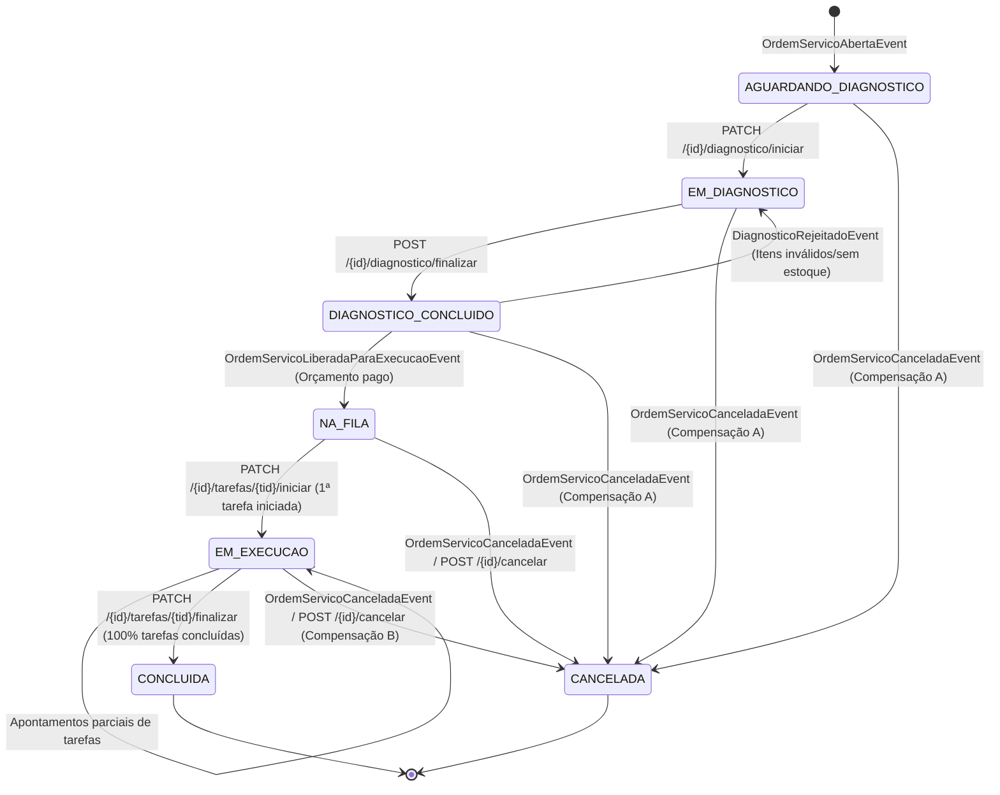
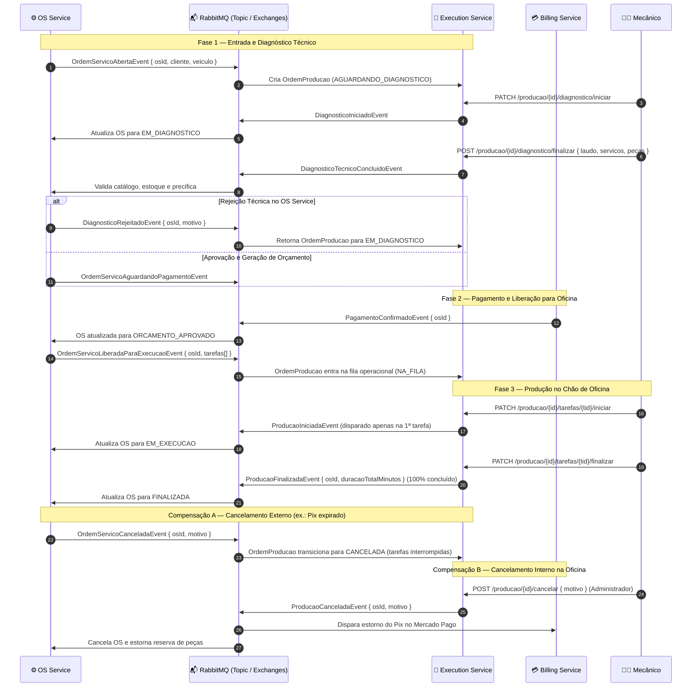
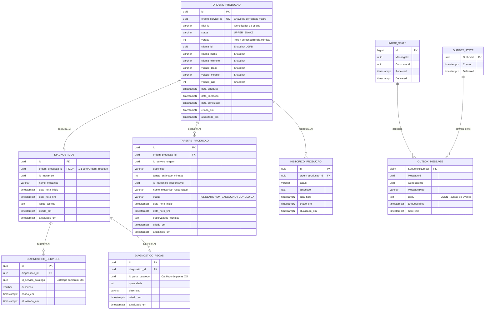

# 📐 SPEC.md — Especificação Técnica e Comportamental do Execution Service

> **Serviço:** `techchallenge-execution-service`  
> **Versão:** `v1.0.0` (Fase 4 SOAT — FIAP)  
> **Framework:** .NET 8 (C# 12)  
> **Bancos de Dados & Mensageria:** PostgreSQL 16 + RabbitMQ 3.13 + MassTransit 8.3.4  
> **Status de Implementação:** Etapas 1 a 5 concluídas (Domínio, Persistência, Use Cases, REST API e Saga Coreografada)

---

## 1. Visão Geral e Limites de Contexto (Bounded Context)

O **Execution & Production Service** é o microsserviço responsável pela gestão operacional do chão de oficina automotiva. Ele gerencia todo o ciclo de vida técnico do veículo após a entrada pelo balcão:
1. **Inspeção Técnica e Diagnóstico:** Atribuição do mecânico avaliador, registro de laudo e sugestão de serviços e peças.
2. **Esteira de Produção (FIFO):** Fila de ordens de serviço com orçamento aprovado e pago.
3. **Apontamento de Tarefas:** Registro preciso de início e término de cada serviço, cálculo de tempos estimados vs. realizados e métricas de eficiência por profissional.
4. **Participação na Saga Coreografada:** Integração assíncrona desacoplada com o **OS Service** (`fase1-tech-challenge`) e o **Billing Service**.

### Diretrizes de Privacidade e LGPD
- **Cliente:** Armazena exclusivamente `IdCliente (Guid)`, `Nome` e `Telefone` (para aviso via WhatsApp/SMS). **CPF/CNPJ e e-mail não entram neste serviço**.
- **Veículo:** Armazena dados essenciais para identificação no pátio: `Placa`, `Modelo` e `Ano`.

---

## 2. Arquitetura de Software (Clean Architecture)

O serviço adota os princípios da Clean Architecture com separação rigorosa de responsabilidades e regras de dependência unidirecionais validadas por testes de arquitetura automatizados (`LayerDependencyTests`).

```mermaid
flowchart TD
    subgraph API["🌐 Fiap.TechChallenge.Execution.Api"]
        CTRL["ProducaoController (/api/v1/producao)"]
        MID_CORR["CorrelationIdMiddleware"]
        MID_EXC["ExceptionHandlingMiddleware (RFC 7807)"]
        AUTH_JWT["JwtConfiguration (HMAC-SHA256)"]
        SWAGGER["SwaggerConfiguration (Bearer Auth)"]
        PROBES["HealthChecks (/health/live, /health/ready)"]
    end

    subgraph APP["⚡ Fiap.TechChallenge.Execution.Application"]
        UC["Casos de Uso (Commands)\n- IniciarDiagnostico\n- FinalizarDiagnostico\n- IniciarTarefa\n- FinalizarTarefa\n- CancelarProducao"]
        QUERIES["Consultas (Queries)\n- ObterFilaProducao\n- ObterDiagnosticosPendentes\n- ObterDetalhesOrdemProducao\n- ObterMetricasProdutividade"]
        CONSUMERS["MassTransit Consumers\n- OrdemServicoAbertaConsumer\n- DiagnosticoRejeitadoConsumer\n- OrdemServicoLiberadaParaExecucaoConsumer\n- OrdemServicoCanceladaConsumer"]
        EVENTS["Contratos de Eventos (Inbound / Outbound)\nNamespace: Fiap.TechChallenge.Contracts.Events"]
        INT_PUB["IEventPublisher"]
    end

    subgraph DOMAIN["💎 Fiap.TechChallenge.Execution.Domain"]
        AGG["Agregado Raiz: OrdemProducao"]
        ENTITIES["Entidades: Diagnostico, TarefaProducao,\nHistoricoProducao, ServicoSugerido, PecaSugerida"]
        VO["Value Objects: ClienteSnapshot, VeiculoSnapshot,\nStatusOrdemProducao, StatusTarefaProducao"]
        EXCEPTIONS["Exceções de Domínio Tipadas"]
        REPO_INT["IOrdemProducaoRepository"]
    end

    subgraph INFRA["🗄️ Fiap.TechChallenge.Execution.Infrastructure"]
        REPO_IMPL["OrdemProducaoRepository (EF Core 8)"]
        DBCONTEXT["AppDbContext (PostgreSQL 16)"]
        OUTBOX["Transactional Outbox / Inbox (MassTransit)"]
        MT_CONFIG["MassTransitConfiguration (RabbitMQ 3.13)"]
        MT_PUB["MassTransitEventPublisher"]
        SSM["SsmSecretResolver (AWS SSM / Local Fallback)"]
    end

    API --> APP
    API --> INFRA
    APP --> DOMAIN
    INFRA --> DOMAIN
    INFRA --> APP
```

---

## 3. Máquina de Estados e Ciclo de Vida da Ordem de Produção

A máquina de estados da `OrdemProducao` é estrita, determinística e persistida com strings `UPPER_SNAKE` no banco de dados.

### Ciclo de Vida das Tarefas Individuais (`TarefaProducao`)
- `PENDENTE`: Tarefa aprovada pelo orçamento aguardando mecânico assumir.
- `EM_EXECUCAO`: Mecânico iniciou a execução da tarefa no veículo.
- `CONCLUIDA`: Mecânico finalizou o serviço, registrando data/hora fim e observações técnicas.
- `INTERROMPIDA`: Tarefa cancelada devido ao cancelamento da ordem de produção.

---

## 4. Saga Coreografada e Topologia de Mensageria

A comunicação assíncrona opera via **MassTransit 8.3.4** sobre **RabbitMQ 3.13** com topologia *Publish/Subscribe* e roteamento canônico no namespace `Fiap.TechChallenge.Contracts.Events`.

### 4.1. Fluxo Sequencial da Saga (Caminho Feliz e Compensações)

---

### 4.2. Catálogo de Contratos de Eventos

Todos os contratos herdam o envelope padronizado contendo `EventId (Guid)`, `CorrelationId (= osId)`, `OccurredAt (DateTime UTC)` e `Version (int = 1)`.

#### Eventos de Entrada (Inbound — Consumidos pelo Execution Service)

| Evento | Fila RabbitMQ (`ReceiveEndpoint`) | Origem | Ação no Domínio |
|---|---|---|---|
| `OrdemServicoAbertaEvent` | `execution-ordem-servico-aberta` | OS Service | Criação idempotente de `OrdemProducao` no status `AGUARDANDO_DIAGNOSTICO`. |
| `DiagnosticoRejeitadoEvent` | `execution-diagnostico-rejeitado` | OS Service | Reabertura do laudo técnico para o mecânico (`EM_DIAGNOSTICO`). |
| `OrdemServicoLiberadaParaExecucaoEvent` | `execution-os-liberada-execucao` | OS Service | Atribuição das tarefas de reparo aprovadas e entrada na esteira `NA_FILA`. |
| `OrdemServicoCanceladaEvent` | `execution-ordem-servico-cancelada` | OS Service | Cancelamento externo (Compensação A): ordem `CANCELADA` e tarefas interrompidas. |

#### Eventos de Saída (Outbound — Publicados pelo Execution Service)

| Evento | Momento da Publicação | Destinatários | Finalidade |
|---|---|---|---|
| `DiagnosticoIniciadoEvent` | `PATCH /{id}/diagnostico/iniciar` | OS Service | Informa ao cliente/balcão que o mecânico iniciou a inspeção. |
| `DiagnosticoTecnicoConcluidoEvent` | `POST /{id}/diagnostico/finalizar` | OS Service | Envia laudo, serviços e peças para precificação comercial e reserva de estoque. |
| `ProducaoIniciadaEvent` | `PATCH /{id}/tarefas/{tid}/iniciar` | OS Service | Notifica o início efetivo dos reparos no veículo (emitido de forma idempotente só na 1ª tarefa). |
| `ProducaoFinalizadaEvent` | `PATCH /{id}/tarefas/{tid}/finalizar` | OS Service | Notifica o término de 100% dos reparos e reporta a duração total real em minutos. |
| `ProducaoCanceladaEvent` | `POST /{id}/cancelar` | Billing / OS | Aciona a Compensação B: estorno financeiro no gateway e liberação de estoque reservado. |

---

## 5. Persistência Relacional e Transactional Outbox / Inbox

O serviço utiliza **PostgreSQL 16** dedicado (`techchallenge_execution_db`), isolado de outros microsserviços.

### 5.1. Diagrama Entidade-Relacionamento Completo (ERD)

### 5.2. Garantias Transacionais do Transactional Outbox
1. **Atomicidade:** Ao executar qualquer Use Case (ex.: `IniciarDiagnostico`), a chamada `_eventPublisher.PublishAsync(evento)` adiciona o registro na entidade `OutboxMessage` dentro da mesma instância do `AppDbContext`.
2. O método `_repository.AtualizarAsync(ordem)` executa `await _context.SaveChangesAsync()`, persistindo o agregado e a mensagem em uma **única transação ACID**.
3. Um worker em segundo plano do MassTransit lê as mensagens gravadas no banco e as despacha para as exchanges do RabbitMQ, garantindo que nenhum evento seja perdido em caso de queda de rede ou indisponibilidade temporária do broker.

---

## 6. Especificação da API REST (`/api/v1/producao`)

A API expõe 10 rotas seguras com autenticação stateless via token JWT assinado por chave simétrica HMAC-SHA256 compartilhada no ecossistema (`Jwt:Secret`).

### 6.1. Matriz de Endpoints e Autorização

| Método | Rota | Roles Autorizadas | Finalidade | Status Sucesso | Códigos de Erro Possíveis |
|---|---|---|---|:---:|:---:|
| `GET` | `/api/v1/producao/fila` | `Mecanico`, `Operador`, `Administrador` | Lista ordens na esteira operacional com filtro opcional por status e filial. | `200 OK` | `401`, `400` |
| `GET` | `/api/v1/producao/diagnosticos/pendentes` | `Mecanico`, `Administrador` | Lista ordens aguardando inspeção diagnóstica inicial. | `200 OK` | `401`, `403` |
| `GET` | `/api/v1/producao/{id}` | `Mecanico`, `Operador`, `Administrador` | Retorna o agregado completo da Ordem de Produção pelo seu ID. | `200 OK` | `401`, `404` |
| `GET` | `/api/v1/producao/ordem-servico/{osId}` | `Mecanico`, `Operador`, `Administrador` | Busca a Ordem de Produção pelo ID da OS de origem. | `200 OK` | `401`, `404` |
| `PATCH` | `/api/v1/producao/{id}/diagnostico/iniciar` | `Mecanico`, `Administrador` | Assume a OS e inicia a análise técnica no pátio. | `200 OK` | `401`, `403`, `404`, `409` |
| `POST` | `/api/v1/producao/{id}/diagnostico/finalizar` | `Mecanico`, `Administrador` | Conclui o diagnóstico enviando laudo, serviços e peças sugeridos. | `200 OK` | `400`, `401`, `403`, `404`, `409` |
| `PATCH` | `/api/v1/producao/{id}/tarefas/{tarefaId}/iniciar` | `Mecanico`, `Administrador` | Inicia o apontamento de uma tarefa específica de reparo. | `200 OK` | `401`, `403`, `404`, `409` |
| `PATCH` | `/api/v1/producao/{id}/tarefas/{tarefaId}/finalizar` | `Mecanico`, `Administrador` | Finaliza o reparo apontando data de conclusão e observações. | `200 OK` | `401`, `403`, `404`, `409` |
| `POST` | `/api/v1/producao/{id}/cancelar` | `Administrador` | Cancela a produção (aciona Compensação B). | `200 OK` | `400`, `401`, `403`, `404`, `409` |
| `GET` | `/api/v1/producao/metricas/produtividade` | `Administrador` | Relatório de tarefas estimadas vs. realizadas e índice de eficiência. | `200 OK` | `400`, `401`, `403` |

### 6.2. Middlewares e Padronização de Respostas

#### Propagação de Correlação (`CorrelationIdMiddleware`)
- Lê o cabeçalho HTTP `X-Correlation-ID` da requisição; caso ausente, gera um novo `Guid`.
- Injeta o `X-Correlation-ID` na resposta HTTP e em todos os escopos de log estruturado (junto com o `traceparent` do OpenTelemetry).

#### Tratamento Centralizado de Erros (`ExceptionHandlingMiddleware`)
Respostas de erro seguem estritamente a especificação **RFC 7807** (`application/problem+json`):

| Exceção de Domínio | Status HTTP | Título do Erro |
|---|:---:|---|
| `OrdemProducaoNaoEncontradaException` | `404 Not Found` | Recurso não encontrado |
| `TarefaProducaoNaoEncontradaException` | `404 Not Found` | Recurso não encontrado |
| `TransicaoEstadoInvalidaException` | `409 Conflict` | Transição de estado inválida |
| `ConflitoConcorrenciaException` | `409 Conflict` | Conflito de concorrência otimista (token `versao`) |
| `MecanicoNaoAutorizadoException` | `403 Forbidden` | Operação não autorizada para o mecânico |
| `DomainException` / `ArgumentException` | `400 Bad Request` | Regra de negócio violada |
| `UnauthorizedAccessException` | `401 Unauthorized` | Não autenticado |
| Outras exceções não tratadas | `500 Internal Server Error` | Erro interno no servidor |

---

## 7. Probes de Infraestrutura (Kubernetes)

- **Liveness Probe (`/health/live`):** Valida se o processo HTTP responde sem consultar dependências externas.
- **Readiness Probe (`/health/ready`):** Executa verificações marcadas com a tag `ready` (conectividade com o PostgreSQL dedicado).

---

## 8. Cobertura de Testes Automatizados

O serviço possui **111 testes automatizados**, categorizados em:
1. **Testes Unitários de Domínio e Aplicação (100 testes):**
   - Transições válidas e inválidas da máquina de estados do agregado `OrdemProducao`.
   - Use Cases de comando e queries operacionais com `NSubstitute`.
   - Testes unitários isolados dos 4 Consumers da Saga com validação de idempotência.
   - Conformidade de camadas Clean Architecture via `LayerDependencyTests` (`NetArchTest`).
2. **Testes de Integração com Testcontainers (11 testes):**
   - Subida real de container `postgres:16-alpine` com execução automática das Migrations do EF Core.
   - Subida real de container `rabbitmq:3.13-management-alpine` validando publicação, consumo e compensações da Saga.
   - Teste de gravação atômica na tabela `"OutboxMessage"` via `WebApplicationFactory<Program>`.

