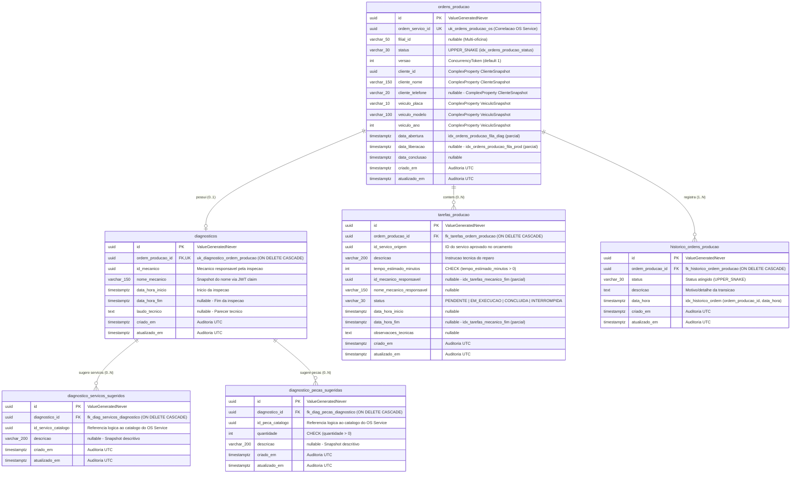

# 🗄️ Modelo Relacional e Diagrama ER — Execution & Production Service (Fase 4)

**Pós-Graduação em Software Architecture (SOAT) — FIAP**  
**Microsserviço:** `techchallenge-execution-service`  
**Banco de Dados:** PostgreSQL 16 (`techchallenge_execution_db`)  
**ORM & Mapeamento:** Entity Framework Core 8 (`Npgsql.EntityFrameworkCore.PostgreSQL`)

---

## 1. Justificativa Formal da Escolha do Banco de Dados

### 1.1. Por que PostgreSQL 16 no Execution Service?
O contexto delimitado (*Bounded Context*) de **Chão de Oficina e Produção** gerencia o diagnóstico técnico veicular, a esteira operacional FIFO de reparos e o apontamento concorrente de tarefas por mecânicos:

1. **Consistência Transacional Estrita (ACID):** Toda transição de estado na `OrdemProducao` envolve atualizações coordenadas entre a ordem raiz, o laudo diagnóstico, a lista de tarefas e o registro imutável de auditoria (`historico_ordens_producao`).
2. **Controle de Concorrência Otimista Nativo:** Dois mecânicos não podem iniciar a mesma tarefa ou assumir o mesmo diagnóstico simultaneamente. O token `versao` garante isolamento sem locks pessimistas de longa duração.
3. **Índices Parciais B-Tree (`WHERE status = ...`):** Consultas de alta frequência na oficina (`GET /fila` e `GET /diagnosticos/pendentes`) varrem apenas a fração ativa da tabela em sub-milissegundos, ignorando o histórico de ordens `CONCLUIDA` ou `CANCELADA`.
4. **Transactional Outbox & Inbox via EF Core:** Suporte nativo ao `MassTransit.EntityFrameworkCore` na mesma transação ACID do banco relacional.

### 1.2. Isolamento de Dados e Persistência Poliglota no Ecossistema
Nenhum microsserviço acessa o banco de dados de outro:
* **OS Service (`fase1-tech-challenge`):** PostgreSQL 16 (SQL) — Clientes, Veículos, Catálogo, Estoque e Status Macro.
* **Billing Service (`techchallenge-billing-service`):** MongoDB 7.0 (NoSQL) — Orçamentos, Checkout Pix Mercado Pago e Estornos.
* **Execution Service (`techchallenge-execution-service`):** PostgreSQL 16 dedicado (`techchallenge_execution_db`, SQL) — Diagnóstico Técnico, Fila FIFO e Apontamento de Tarefas.

---

## 2. Diagrama Entidade-Relacionamento (ERD) Completo

O diagrama abaixo reflete fielmente o schema relacional mapeado no [`AppDbContext`](../src/Fiap.TechChallenge.Execution.Infrastructure/Database/AppDbContext.cs) e gerado pela migration [`InitialExecutionSchema`](../src/Fiap.TechChallenge.Execution.Infrastructure/Database/Migrations):

---

## 3. Explicação dos Relacionamentos e Cardinalidades

### 3.1. `ordens_producao` → `diagnosticos` (1:0..1)
* Uma **Ordem de Produção** nasce no estado `AGUARDANDO_DIAGNOSTICO` sem registro na tabela `diagnosticos`.
* Quando o mecânico inicia a inspeção técnica (`IniciarDiagnostico`), o registro `diagnosticos` é criado e vinculado via FK única `ordem_producao_id` (`uk_diagnostico_ordem_producao`).
* Caso o diagnóstico seja reaberto por inconsistência de estoque (`DiagnosticoRejeitadoEvent`), o mesmo registro 1:1 é atualizado na revisão do laudo.

### 3.2. `diagnosticos` → `diagnostico_servicos_sugeridos` e `diagnostico_pecas_sugeridas` (1:N)
* Ao finalizar o laudo técnico, o mecânico aponta os serviços (`id_servico_catalogo`) e peças/insumos (`id_peca_catalogo`, com constraint `ck_diag_pecas_quantidade_positiva: quantidade > 0`) necessários para o reparo.
* O Execution Service **não** armazena preços comerciais; os IDs sugeridos são publicados via `DiagnosticoTecnicoConcluidoEvent` para que o OS Service valide o catálogo, reserve o estoque e precifique o orçamento.

### 3.3. `ordens_producao` → `tarefas_producao` (1:N)
* Após a aprovação e pagamento do orçamento no Billing Service, o Execution Service consome `OrdemServicoLiberadaParaExecucaoEvent` e cria as **Tarefas de Produção** (`tarefas_producao`) com `tempo_estimado_minutos > 0` (`ck_tarefas_tempo_estimado_positivo`).
* Cada tarefa possui seu próprio ciclo de vida (`PENDENTE` ➔ `EM_EXECUCAO` ➔ `CONCLUIDA` ou `INTERROMPIDA`) e registra o mecânico responsável e os timestamps reais de execução.

### 3.4. `ordens_producao` → `historico_ordens_producao` (1:N)
* Toda mudança de status em `ordens_producao` insere de forma atômica um registro imutável em `historico_ordens_producao`, garantindo rastreabilidade completa de auditoria.

---

## 4. Índices Especializados e Otimizações PostgreSQL

| Nome do Índice / Constraint | Tabela | Colunas | Filtro Parcial / Tipo | Finalidade Operacional |
|---|---|---|---|---|
| `uk_ordens_producao_os` | `ordens_producao` | `(ordem_servico_id)` | `UNIQUE` B-Tree | Garante idempotência na abertura da ordem via mensageria e busca rápida por `osId` |
| `uk_diagnostico_ordem_producao` | `diagnosticos` | `(ordem_producao_id)` | `UNIQUE` B-Tree | Garante a cardinalidade estrita `1:1` entre Ordem de Produção e Diagnóstico |
| `idx_ordens_producao_status` | `ordens_producao` | `(status)` | B-Tree | Filtros administrativos e métricas de gauge por status |
| `idx_ordens_producao_fila_diag` | `ordens_producao` | `(data_abertura)` | `WHERE status = 'AGUARDANDO_DIAGNOSTICO'` | Acelera `GET /api/v1/producao/diagnosticos/pendentes` (FIFO de chegada) |
| `idx_ordens_producao_fila_prod` | `ordens_producao` | `(data_liberacao)` | `WHERE status = 'NA_FILA'` | Acelera `GET /api/v1/producao/fila` ordenada por liberação (FIFO de produção) |
| `idx_tarefas_mecanico_fim` | `tarefas_producao` | `(id_mecanico_responsavel, data_hora_fim)` | `WHERE status = 'CONCLUIDA'` | Acelera `GET /api/v1/producao/metricas/produtividade` (estimado × realizado por mecânico) |
| `idx_historico_ordem` | `historico_ordens_producao` | `(ordem_producao_id, data_hora)` | B-Tree Composto | Recuperação ordenada da linha do tempo de auditoria da ordem |

---

## 5. Decisões de Mapeamento no Entity Framework Core 8

1. **Value Objects via `ComplexProperty` (`ClienteSnapshot` e `VeiculoSnapshot`):**
   - Mapeados inline na tabela `ordens_producao` (`cliente_id`, `cliente_nome`, `cliente_telefone`, `veiculo_placa`, `veiculo_modelo`, `veiculo_ano`) usando o recurso `ComplexProperty` do EF Core 8.
   - Em conformidade com a **LGPD**, CPF/CNPJ e e-mail do cliente não existem neste schema.
2. **Chaves Primárias Geradas no Domínio (`ValueGeneratedNever`):**
   - Os identificadores `UUID` são instanciados pelo próprio domínio C# (`EntidadeBase`), permitindo que o ChangeTracker do EF Core rastreie com precisão a adição de novas entidades filhas (`Diagnostico`, `TarefaProducao`, `HistoricoProducao`, `ServicoSugerido`, `PecaSugerida`) durante atualizações do agregado.
3. **Prevenção de Explosão Cartesiana (`AsSplitQuery`):**
   - As consultas que carregam o agregado completo em [`OrdemProducaoRepository`](../src/Fiap.TechChallenge.Execution.Infrastructure/Database/Repositories/OrdemProducaoRepository.cs) utilizam `.AsSplitQuery()`, evitando produto cartesiano entre `Tarefas`, `Historico`, `ServicosSugeridos` e `PecasSugeridas`.

